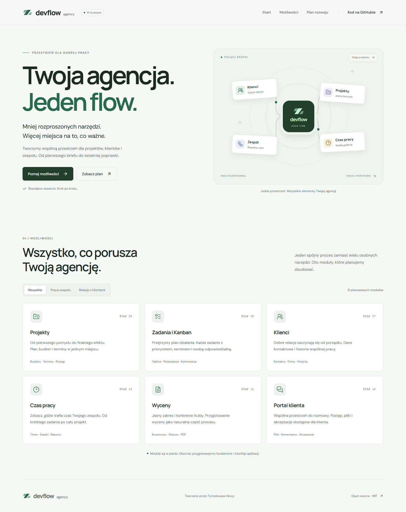

# DevFlow Agency

Modularna aplikacja SaaS do zarządzania agencją: klientami, projektami, zadaniami, zespołem, czasem pracy i wycenami. Projekt portfolio rozwijany stopniowo z naciskiem na typowanie, dostępność, bezpieczeństwo danych i przejrzystą historię zmian.

**Stan: ETAP 1 zakończony, ETAP 2 w realizacji.** Fundament i ekran powitalny zostały scalone do `main` przez PR #1. Na gałęzi `feat/app-shell` powstaje design system i układ aplikacji; gotowe są wspólne tokeny, zapamiętywany wybór motywu i pierwsze komponenty shadcn/ui. Logowanie, baza oraz moduły biznesowe są zaplanowane; nie są jeszcze zaimplementowane. Aplikacja nie korzysta z fikcyjnego backendu ani demonstracyjnych statystyk.

[Repozytorium](https://github.com/TymoteuszHinca2000/devflow-agency) · [Roadmapa](ROADMAP.md) · [Zasady pracy](AGENTS.md) · [Historia zmian](CHANGELOG.md)

## Dostępne obecnie

- React i TypeScript strict, także z kontrolą opcjonalnych pól i indeksów.
- Vite, alias `@/` i Tailwind CSS 4 przez oficjalny plugin Vite.
- ESLint z kontrolą typów, Prettier, EditorConfig i spójne końce linii.
- Struktura katalogów przygotowana pod moduły biznesowe.
- Vitest, React Testing Library i konfiguracja Playwright dla desktopu i telefonu.
- `.env.example`, wykluczenie lokalnej konfiguracji i wersjonowany lockfile.
- Nagłówek z nawigacją desktopową i wysuwanym, modalnym panelem mobilnym.
- Sekcja powitalna z ilustracją koncepcji produktu oraz linkami do kodu i planu rozwoju.
- Wspólne logo, przyciski w formie linków, lokalne fonty i favicon.
- Wspólne tokeny kolorów, fontów, odstępów, zaokrągleń i fokusu, dostępne również w Tailwind CSS.
- Lokalne komponenty shadcn/ui: `Button`, `Card`, `Input`, `Label`, `Dialog`, `Sheet` i `Table`, dostosowane do palety DevFlow.
- Dialogi i panele z tytułem, opisem, zamykaniem przez Escape i tło, blokadą przewijania oraz zarządzaniem fokusem.
- Wspólna tabela z podpisem, nagłówkami kolumn i wierszy, stopką oraz obszarem przewijania dostępnym klawiaturą. Komponent jest przygotowany do użycia w kolejnych modułach.
- Wspólny przycisk w akcjach strony i wspólna karta w katalogu; stany pól przygotowane do kolejnych formularzy.
- Wybór motywu jasnego, ciemnego lub systemowego z zapamiętywaniem ustawienia i obsługą ograniczenia ruchu.
- Reakcja na zmianę motywu systemu i synchronizacja wyboru między kartami przeglądarki.
- Odczyt zapisanego motywu przed uruchomieniem Reacta oraz obsługa blokady zapisu ustawień.
- Skip link, obsługa klawiatury i przywracanie fokusu po zamknięciu menu.
- Katalog sześciu planowanych modułów z filtrami „Wszystkie”, „Praca zespołu” i „Relacje z klientami”.
- Licznik wyników dostępny dla czytników ekranu oraz obsługa filtrów klawiaturą.
- Przejście do katalogu przez przycisk „Poznaj możliwości” i link w nagłówku.
- Roadmapa czterech obszarów obejmujących 15 etapów, z rozwijanymi opisami i oznaczeniem bieżącego etapu 2.
- Nawigacja do roadmapy z menu i przycisku „Zobacz plan” oraz odnośnik do pełnego dokumentu na GitHubie.

Następne małe zadanie ETAPU 2 to React Router i podstawowe trasy aplikacji. Układ panelu oraz dalsze komponenty pozostają w planie tego etapu. Nie ma jeszcze wdrożonego demo.

## Podgląd aktualnej sekcji powitalnej



[Ciemny motyw](docs/screenshots/welcome-dark.png) · [Widok mobilny](docs/screenshots/welcome-mobile.png) · [Wybór motywu na telefonie](docs/screenshots/theme-selector-mobile.png)

Motyw wybierzesz w nawigacji. Przy szerokości do 1000 px otwórz wysuwany panel. Fokus pozostaje w nim do zamknięcia; Escape, przycisk zamknięcia i kliknięcie tła przywracają go do przycisku menu. Wybranie sekcji przenosi fokus do jej treści, a poszerzenie okna do 1001 px zamyka panel i aktywuje nawigację desktopową. „Systemowy” śledzi ustawienia systemu na bieżąco; wybór ręczny pozostaje po odświeżeniu. Gdy przeglądarka blokuje zapis, ustawienie działa w bieżącej sesji.

## Stack

| Obszar                  | Zainstalowane                                                                | Planowane                                                 |
| ----------------------- | ---------------------------------------------------------------------------- | --------------------------------------------------------- |
| Frontend                | React 19.3.1, TypeScript 6.0.3, Vite 8.3.4                                   | React Router, TanStack Query                              |
| Interfejs               | Tailwind CSS 4.3.3, shadcn/ui (Radix), Lucide React, fonty Manrope i DM Sans | Recharts, dnd-kit                                         |
| Formularze i stan       | Stan lokalny React                                                           | React Hook Form, Zod; Zustand przy rzeczywistej potrzebie |
| Backend                 | Brak integracji w ETAPIE 1                                                   | Supabase, PostgreSQL, Auth, Storage, RLS, Edge Functions  |
| Jakość                  | ESLint 10, Prettier 3, Vitest 5, Testing Library, Playwright, axe-core       | Testy modułów i izolacji organizacji                      |
| Automatyzacja i hosting | Lokalne skrypty kontroli jakości                                             | GitHub Actions, Vercel                                    |

Dokładne wersje są w `package.json` i `package-lock.json`. TypeScript 6.0.3 wybrano dla zgodności: zainstalowane `typescript-eslint` wspiera TypeScript `<6.1.0`. Nie wymuszamy nieobsługiwanych zależności przez `--force` ani `--legacy-peer-deps`.

## Wymagania

- Node.js **24.19.0**, zgodny z `.node-version`; pełny zakres określa `engines` w `package.json`.
- npm co najmniej 10.9.0.
- Git.

Vitest 5 i jsdom 30 nie wspierają Node 25. Na Windows z nvm-windows wybierz wspieraną wersję przed instalacją i testami:

```powershell
nvm install 24.19.0
nvm use 24.19.0
node --version
npm --version
```

Zmiana wersji przez nvm-windows może wymagać terminala z odpowiednimi uprawnieniami. Nie jest potrzebna do przeglądania plików ani wykonywania commitów Git.

## Instalacja i uruchomienie

Dla nowej kopii repozytorium:

```powershell
git clone https://github.com/TymoteuszHinca2000/devflow-agency.git
cd devflow-agency
git switch feat/app-shell
npm ci
npm run dev
```

Dla istniejącego katalogu zamiast klonowania:

```powershell
cd C:\Users\hinca\Desktop\DevflowAgency
git status --short --branch
npm ci
npm run dev
```

Vite wypisze lokalny adres, zwykle `http://127.0.0.1:5173`. Jeśli port jest zajęty, użyj adresu wyświetlonego przez serwer. Zatrzymanie: `Ctrl+C`.

## Środowisko

**ETAPY 1 i 2 działają bez `.env`, konta Supabase i kluczy.** `.env.example` dokumentuje wyłącznie przyszłe publiczne wartości:

```dotenv
VITE_SUPABASE_URL=
VITE_SUPABASE_PUBLISHABLE_KEY=
```

Dopiero w ETAPIE 3, po uzgodnieniu konfiguracji Supabase:

```powershell
Copy-Item .env.example .env.local
```

Wszystkie `VITE_*` trafiają do przeglądarki. Nigdy nie umieszczaj w nich sekretów, `service_role` ani hasła PostgreSQL. Lokalne pliki `.env*` są ignorowane przez Git z wyjątkiem pustego `.env.example`.

## Skrypty i testy

| Polecenie              | Działanie                                              |
| ---------------------- | ------------------------------------------------------ |
| `npm run dev`          | Serwer Vite z HMR                                      |
| `npm run typecheck`    | Kontrola typów aplikacji, konfiguracji i E2E           |
| `npm run lint`         | ESLint bez dopuszczania ostrzeżeń                      |
| `npm run format`       | Prettier; modyfikuje pliki                             |
| `npm run format:check` | Sprawdzenie formatowania bez zapisu                    |
| `npm test`             | Jednorazowy Vitest                                     |
| `npm run test:watch`   | Vitest w trybie obserwowania                           |
| `npm run build`        | Kontrola typów i build do `dist/`                      |
| `npm run preview`      | Podgląd istniejącego buildu                            |
| `npm run check`        | Lint, formatowanie, Vitest i build z typami            |
| `npm run test:e2e`     | Playwright: desktop i telefon na produkcyjnym buildzie |

Podstawowa kontrola:

```powershell
npm run check
```

Przy pierwszym użyciu E2E zainstaluj Chromium. Przed testami wykonaj build:

```powershell
npx playwright install chromium
npm run build
npm run test:e2e
```

Testy importują `test` i `expect` z `e2e/fixtures.ts`. Każdy test uruchamia podgląd produkcyjnego `dist/` na wolnym porcie przez API Vite i zamyka go w `finally` przez `server.close()`. Nie używa starszego, już uruchomionego podglądu ani systemowego zamykania drzewa procesów.

Raporty HTML trafiają do `playwright-report/`, materiały diagnostyczne do `test-results/`; oba katalogi są ignorowane przez Git.

**Weryfikacja ekranu powitalnego, katalogu i roadmapy na Node 24.19.0:**

- Lint, formatowanie, TypeScript i build: poprawne.
- Vitest / Testing Library: 12 zaliczonych testów.
- Playwright / Chromium: 50 zaliczonych scenariuszy na desktopie i telefonie; proces zakończył się kodem `0`.
- Sprawdzono filtrowanie, licznik wyników, nawigację do sekcji, menu mobilne, klawiaturę, fokus i ograniczenie ruchu.
- Roadmapa: domyślnie otwarty bieżący obszar, niezależne rozwijanie pozostałych, obsługa Enter i Spacji oraz zachowanie fokusu.
- Sprawdzono ręczne nadpisanie motywu systemowego, zapis i odświeżanie, reakcję na zmiany systemu, klawiaturę, synchronizację kart, nieprawidłowy zapis i blokadę pamięci przeglądarki.
- Osobne scenariusze potwierdzają odczyt zapisanego motywu także przed załadowaniem modułu React.
- axe-core: brak automatycznie wykrytych naruszeń WCAG A/AA w jasnym i ciemnym widoku na obu urządzeniach, także po otwarciu wszystkich opisów roadmapy i menu mobilnego z wyborem motywu.
- Przejrzano zrzuty dla szerokości 320, 390, 768 i 1440 px; bez poziomego przepełnienia.
- W odizolowanym podglądzie komponentów UI sprawdzono oba motywy, fokus pól, opisy błędów, wysokość 44 px i brak przepełnienia; axe nie wykrył naruszeń sprawdzanych reguł WCAG A/AA.
- Testy panelu obejmują zapętlenie fokusu, zamknięcie przez Escape, przycisk i tło, przywracanie przewijania, przejście do sekcji i zmianę szerokości okna. Sprawdzono też widok 320 × 320 px z ograniczeniem ruchu.
- W osobnym podglądzie sprawdzono dialog i cztery kierunki panelu w 20 kombinacjach rozmiarów i motywów, z kontrolą klawiatury, granic ekranu, błędów wykonania i axe. Podgląd nie jest dodatkową stroną aplikacji.
- W odizolowanym podglądzie tabeli sprawdzono 6 wariantów szerokości i motywu oraz widok z danymi i pusty. Przewijanie strzałkami, przechodzenie fokusu, semantyka nagłówków i podpisu, brak przepełnienia strony oraz audyty axe zakończyły się poprawnie. Szczegóły i zrzuty: [Wspólne komponenty UI](docs/ui-components.md).

Kontrole automatyczne i wizualne nie stanowią pełnego audytu dostępności. Kolejne sekcje i moduły otrzymają testy w ramach swoich zadań.

## Architektura

```text
src/
  app/
  components/
    ui/
    layout/
    shared/
  features/
    auth/
    dashboard/
    organizations/
    clients/
    projects/
    tasks/
    time-tracking/
    quotes/
    client-portal/
    notifications/
    settings/
    welcome/
  hooks/
  lib/
  services/
  types/
  styles/
  test/
e2e/
supabase/
  migrations/
  functions/
```

Komponenty, hooki, serwisy, walidacja i typy modułu pozostają w jego katalogu `features/`. Elementy rzeczywiście wspólne trafiają do katalogów współdzielonych. Katalogi z `.gitkeep` są na razie puste.

Katalog na stronie startowej ma dane opisowe w `src/features/welcome/data/planned-modules.ts` oraz osobne style w `src/features/welcome/styles/module-overview.css`. Filtry działają lokalnie w React. Opisy przedstawiają plan produktu i nie zastępują danych z przyszłego backendu.

Roadmapa ma osobne dane w `src/features/welcome/data/development-phases.ts` oraz style w `src/features/welcome/styles/development-roadmap.css`. Natywne elementy HTML `details` i `summary` obsługują rozwijanie i klawiaturę. Pierwszy obszar obejmuje etapy 1–2, a etykieta wskazuje obecnie realizowany etap 2.

Wspólne tokeny znajdują się w `src/styles/tokens.css`, a provider motywu w `src/lib/theme/`. `public/theme-init.js` odczytuje preferencję przed uruchomieniem aplikacji. Szczegóły użycia i architektury: [Wspólne style i motyw](docs/design-tokens.md).

Komponenty UI są w `src/components/ui/`, a adapter ich semantycznych tokenów w `src/styles/ui.css`. `components.json` opisuje konfigurację shadcn/ui. Przykłady i podgląd: [Wspólne komponenty UI](docs/ui-components.md).

Docelowo PostgreSQL i RLS zapewnią izolację organizacji, Storage będzie prywatny, a operacje wymagające zaufanej logiki obsłużą Edge Functions. W ETAPIE 1 nie ma migracji, seeda ani połączenia z bazą. Szczegóły: [ROADMAP.md](ROADMAP.md) i [AGENTS.md](AGENTS.md).

## Planowane funkcjonalności

- Rejestracja, logowanie, Google OAuth, reset hasła, sesje i profil z awatarem.
- Wiele organizacji, role, zaproszenia i izolacja danych.
- Dashboard z wykresami, aktywnościami, terminami i czasem pracy.
- Klienci, projekty, załączniki i historia współpracy.
- Zadania, podzadania, komentarze i dostępny Kanban z drag & drop.
- Timer, ręczne wpisy czasu, stawki, raporty i eksport.
- Wyceny, pozycje kosztorysu, historia i PDF.
- Portal klienta: projekty, komentarze, pliki i akceptacja wycen.
- Ustawienia konta i preferencje powiadomień.

To zakres docelowy, a nie obecnie dostępne funkcje.

## Git workflow

Branch roboczy ETAPU 2: `feat/app-shell`, utworzony z `main` po scaleniu ETAPU 1 przez PR #1 (`56029a8`). Agent przygotowuje zmiany, a użytkownik wykonuje operacje Git po otrzymaniu instrukcji. Agent wstrzymuje edycję do potwierdzenia wykonania poleceń.

Przed pracą sprawdzaj:

```powershell
git status --short --branch
git branch -vv
```

Stosuj spójne commity według Conventional Commits. Przed commitem przejrzyj diff i wykonaj właściwe kontrole; po commicie sprawdź status. Pierwsza publikacja: `git push -u origin nazwa-brancha`. Bez force push i automatycznego merge do `main`.

## Dokumentacja konfiguracji

- [Vite — rozpoczęcie pracy](https://vite.dev/guide/)
- [Tailwind CSS — integracja z Vite](https://tailwindcss.com/docs/installation/using-vite)
- [typescript-eslint — wspierane zależności](https://typescript-eslint.io/users/dependency-versions/)
- [Vite — publiczne zmienne środowiskowe](https://vite.dev/guide/env-and-mode)
- [Vite — API podglądu](https://vite.dev/guide/api-javascript#preview)
- [Playwright — kontrola dostępności](https://playwright.dev/docs/accessibility-testing)

## Licencja

[MIT](LICENSE) — © 2026 Tymoteusz Hinca.

Adaptowane komponenty shadcn/ui zachowują informację o autorze i licencji: [Third-party notices](docs/third-party-notices.md).
