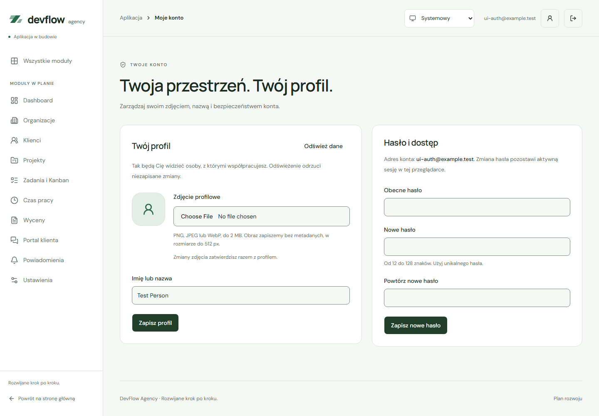

# Odzyskiwanie konta, hasło i profil — ETAP 4, część 3

Trzeci zakres jest przygotowywany na `feat/account-management`, utworzonej przez użytkownika z `feat/authentication` przy `1d2942e`. Obejmuje odzyskiwanie hasła, zmianę hasła, nazwę profilu i prywatny awatar. Nie wymaga migracji ani nowych zależności. Logowanie Google pozostaje odłożone.

## Dostępne adresy

| Adres              | Zachowanie                                                             |
| ------------------ | ---------------------------------------------------------------------- |
| `/forgot-password` | Neutralna prośba o wiadomość, walidacja e-maila i odliczanie 60 sekund |
| `/auth/recovery`   | Sprawdzenie PKCE po kliknięciu i formularz nowego hasła po weryfikacji |
| `/app/account`     | Chroniony profil i zmiana hasła z potwierdzeniem obecnego hasła        |

Do profilu prowadzi przycisk „Moje konto” w topbarze, również na telefonie. Planowane `/app/settings` pozostaje osobnym modułem ETAPU 13. E-mail konta jest informacją tylko do odczytu.

## Hasło i link recovery

Prośba używa `resetPasswordForEmail` z adresem `/auth/recovery` bieżącego originu. Przyjęta prośba pokazuje neutralny komunikat, niezależny od istnienia konta. Potwierdzenie przyjęcia nie oznacza gwarancji dostarczenia. Odliczanie współdzieli termin z ponownym potwierdzaniem e-maila; zapisuje wyłącznie timestamp w `sessionStorage`. Limity serwera nadal obowiązują.

Callback przyjmuje jeden kod PKCE i opcjonalny poprawny `sb_flow_id`. Odrzuca tokeny z fragmentu/query, surowe błędy oraz niezgodny rodzaj linku. Kod pozostaje do kliknięcia, by odświeżenie przed wymianą go nie gubiło. Nie jest automatycznie wymieniany przez efekt Reacta. Po wymianie lub błędzie parametry są usuwane; dokument używa `no-referrer`.

Serwis wymaga wyniku wymiany oznaczonego przez SDK jako recovery. Wznowienie po odświeżeniu korzysta z `getClaims()`, które weryfikuje JWT, oraz dodatkowego `getUser()`. Wymagamy właściwego wystawcy, odbiorcy, użytkownika, identyfikatora sesji i niedawnej metody `recovery` w `amr`. Zwykłe logowanie, metadane użytkownika ani parametr URL nie otwierają resetu. Okno wynosi maksymalnie 30 minut od pierwotnego potwierdzenia, bez przedłużania przy odświeżeniu. Przed zapisem dowód jest sprawdzany ponownie. [Pola JWT i metody uwierzytelnienia](https://supabase.com/docs/guides/auth/jwt-fields).

Nie zapisujemy własnych tokenów, kodów ani uprawnienia resetu. SDK zarządza sesją; w `sessionStorage` zapisujemy jedynie znacznik ukończenia dla identyfikatora sesji, który blokuje ponowne otwarcie ukończonego formularza w tej karcie i nigdy nie nadaje dostępu. Blokada tego storage nie blokuje zmiany hasła; wtedy lokalny znacznik nie przetrwa odświeżenia. Po wygaśnięciu sesji, wylogowaniu albo końcu okna recovery należy poprosić o nową wiadomość. Istniejąca aktywna sesja nie jest automatycznie zastępowana linkiem innego konta.

Zmiana z poziomu konta ponownie sprawdza użytkownika i obecne hasło przez `signInWithPassword`, następnie wywołuje `updateUser`. Reguła nowych haseł to 12–128 znaków bez przycinania. Błędne powtórzenie i puste obecne hasło są odrzucane przed zapisem. Reguły formularza i ograniczenie czasu recovery nie zastępują autoryzacji Supabase Auth; projekt może dodatkowo egzekwować własną politykę haseł i ponownego uwierzytelniania.

Po zmianie aplikacja prosi o wylogowanie innych sesji (`scope: 'others'`), zachowując bieżącą. Niepowodzenie tej dodatkowej operacji jest komunikowane oddzielnie od sukcesu zmiany hasła. Już wydane tokeny JWT mogą pozostać ważne do wygaśnięcia; nie deklarujemy natychmiastowego unieważnienia każdego tokenu. Hasła są czyszczone z formularza po sukcesie i nie trafiają do storage ani logów. [Reset hasła](https://supabase.com/docs/reference/javascript/auth-resetpasswordforemail) · [Bezpieczeństwo haseł](https://supabase.com/docs/guides/auth/password-security) · [Wylogowanie](https://supabase.com/docs/reference/javascript/auth-signout).

## Profil i awatar

Profil pobiera wyłącznie własny wiersz `profiles`; dane odpowiedzi są dodatkowo walidowane. Zapis obejmuje tylko `display_name` i `avatar_path`. Filtr po `updated_at` chroni przed nadpisaniem zmiany z drugiej karty. Konflikt zachowuje wpisaną treść i proponuje odświeżenie danych. Odczyt ma limit 15 sekund, anulowanie po opuszczeniu strony i ponowienie. Stan jest lokalny i znika po wylogowaniu lub zmianie użytkownika.

Awatar:

- Dopuszcza PNG, JPEG i WebP do 2 MiB; odrzuca SVG, pusty plik i niezgodną sygnaturę pliku.
- Dekoduje obraz, odrzuca ponad 25 megapikseli i ponownie koduje piksele do maksymalnie 512 × 512 px, zachowując proporcje oraz usuwając metadane. Limit pikseli jest sprawdzany po dekodowaniu, więc bardzo duże pliki mogą wymagać pamięci przed odrzuceniem.
- Generuje nowy UUID w folderze użytkownika; nie używa nazwy przesłanego pliku. Upload ma `upsert: false`.
- Korzysta z prywatnego bucketa `avatars` i istniejących polityk RLS. Podgląd pobiera autoryzowany Blob i tworzy lokalny URL, zwalniany przy zmianie lub odmontowaniu. Nie generuje publicznego URL.
- Najpierw zapisuje nowy plik, potem wskaźnik profilu, na końcu usuwa poprzedni plik. Usunięcie awatara najpierw usuwa wskaźnik z profilu.
- Czyści nowy upload po jednoznacznym konflikcie zapisu. Przy niejednoznacznym błędzie HTTP nie usuwa pliku, który serwer mógł już powiązać z profilem. Należy odświeżyć dane; może pozostać nieużywany prywatny plik. Nie ma jeszcze automatycznego serwerowego sprzątania takich plików.
- Jeśli usunięcie starego pliku zawiedzie, zachowuje sukces zapisu i pokazuje ostrzeżenie. Nie usuwa aktualnego awatara przed udanym zapisem profilu.

Serwerowe granty i RLS są właściwą granicą uprawnień. Walidacja przeglądarki nie zastępuje kontroli Storage. [Model i bezpieczeństwo bazy](database-security.md).

## Konfiguracja i próba rzeczywista

Użytkownik potwierdził dopisanie w developerskim projekcie dwóch Redirect URLs:

```text
http://127.0.0.1:5173/auth/recovery**
http://localhost:5173/auth/recovery**
```

Site URL pozostaje `http://127.0.0.1:5173`, a wcześniejsze `/auth/confirm**` pozostają na liście. Lokalny `supabase/config.toml` zawiera te same wzorce, ale nie zmienia konfiguracji chmury. Domyślny SMTP ma ograniczenia opisane w [rejestracji](registration.md); używaj swojego adresu uprawnionego do odbioru.

```powershell
npm run dev -- --port 5173 --strictPort
```

1. Otwórz `http://127.0.0.1:5173/app/account`, zaloguj się, zmień nazwę, wybierz obraz i zapisz. Odśwież, sprawdź trwałość danych, usuń awatar i zapisz ponownie.
2. Wyloguj się, otwórz `/forgot-password` i poproś o wiadomość. Otwórz najnowszy link w tej samej przeglądarce i originie. Kliknij „Kontynuuj zmianę hasła”, ustaw nowe hasło, wyloguj się i zaloguj nim ponownie.
3. W profilu sprawdź odmowę zmiany dla błędnego obecnego hasła, następnie poprawną zmianę i logowanie nowym hasłem.
4. Nie przesyłaj do czatu haseł, kodów ani linków potwierdzających. W razie błędu wystarczy komunikat interfejsu.

Użytkownik potwierdził rzeczywisty zapis nazwy i awatara, trwałość po odświeżeniu oraz usunięcie zdjęcia. Pierwsza próba resetu zakończyła się utratą formularza: logi potwierdziły wiadomość, przekierowanie i poprawną wymianę PKCE, a równolegle formatowanie plików przeładowało Vite. Wstępna wersja trzymała dostęp tylko w pamięci i po przeładowaniu go traciła. Dodano wznowienie z weryfikowanej sesji oraz test przeładowania w Vite/StrictMode. Po poprawce użytkownik potwierdził powrót pól po odświeżeniu, zmianę hasła i logowanie nowym hasłem. Automatyczna sesja z nowej wiadomości signup pozostaje do powtórnej próby. Wyników izolowanych testów nie opisujemy jako rzeczywistego dostarczenia poczty.

## Kontrole i podgląd

27 nowych testów aplikacji obejmuje weryfikację obecnego hasła, odmowę innego rodzaju callbacku, granice zweryfikowanych claims, zmianę sesji, wygaśnięcie i wznowienie recovery, częściowy sukces, atomowość wskaźnika awatara, konflikt zapisu i granice plików. 24 nowe przebiegi Playwright sprawdzają cały przepływ w obu rozmiarach urządzeń, rzeczywistą bibliotekę SDK z izolowanym HTTP, dekodowanie obrazu, podgląd, usunięcie, błędy sieci, fokus, szerokość 320 px i wybrane reguły WCAG A/AA. Dodatkowy test Vite/StrictMode obejmuje dwie karty, ręczne odświeżenie, pełne przeładowanie Vite i zapis nowego hasła. Kontrole te nie zastępują pełnego audytu ani testu usług zdalnych.



[Ciemny motyw](screenshots/account-dark.png) · [Telefon](screenshots/account-mobile.png) · [Odzyskiwanie hasła](screenshots/forgot-password-light.png) · [Nowe hasło](screenshots/recovery-form-mobile.png)
