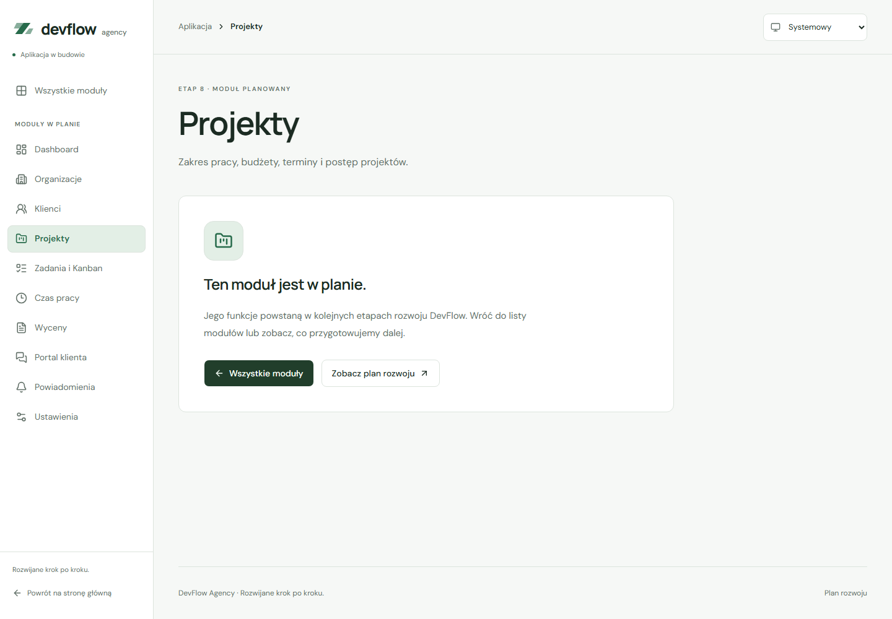

# Sidebar i topbar aplikacji

Trasy `/app` korzystają ze wspólnego `AppLayout`. Na komputerze nawigacja jest stale widoczna w bocznym panelu; do szerokości 1000 px zastępuje ją lewe menu `Sheet`. Topbar pokazuje ścieżkę bieżącej strony i wybór motywu.

## Komponenty

| Plik w `src/components/layout/` | Odpowiedzialność                                                      |
| ------------------------------- | --------------------------------------------------------------------- |
| `app-layout.tsx`                | Układ, skip link, główna treść, stopka i `Outlet`                     |
| `app-sidebar.tsx`               | Logo, informacja o rozwoju, stała nawigacja i powrót na stronę główną |
| `app-topbar.tsx`                | Ścieżka strony, wybór motywu i przycisk menu mobilnego                |
| `app-navigation.tsx`            | Jedna lista adresów dla sidebara i menu, oparta na `app-modules.ts`   |
| `app-mobile-navigation.tsx`     | Stan menu, klawiatura, fokus, zamykanie i zmiana szerokości           |

Style są w `src/styles/app-shell.css`, importowanym centralnie z `globals.css` po `routes.css`. Trasy modułów i nieznane adresy wewnątrz `/app` zachowują ten układ. Globalna strona 404 poza `/app` korzysta z prostszego `RouteLayout`.

## Nawigacja

Linki `NavLink` oznaczają bieżący adres przez `aria-current="page"`. Dopasowanie do końca ścieżki sprawia, że „Wszystkie moduły” nie jest zaznaczone na każdej podstronie. Przy nieznanym adresie nie zaznaczamy nieprawidłowego modułu. Topbar pokazuje wtedy „Nieznany adres”. [React Router — NavLink](https://reactrouter.com/api/components/NavLink).

Na desktopie sidebar i topbar pozostają widoczne przy przewijaniu strony. Wysokość sidebara odpowiada widocznemu ekranowi, a lista linków przewija się niezależnie, dzięki czemu dolne linki są dostępne także przy małej wysokości okna. Na telefonie długie menu przewija się wewnątrz panelu.

Menu otwiera się z fokusem na aktywnym module lub pierwszym linku, gdy adres jest nieznany. Tab i Shift+Tab pozostają w panelu. Escape, kliknięcie tła i przycisk zamknięcia przywracają fokus do przycisku menu. Wybranie linku, także bieżącego modułu, zamyka panel i przekazuje fokus do głównej treści.

Zmiana ścieżki, również przez historię przeglądarki, zamyka menu. Po poszerzeniu okna do co najmniej 1001 px panel zamyka się, a fokus trafia do aktywnego linku sidebara lub pierwszego linku przy nieznanym adresie. Po ponownym zwężeniu menu pozostaje zamknięte. Mechanizm modalny korzysta ze wspólnego `Sheet`, opartego na [Radix Dialog](https://www.radix-ui.com/primitives/docs/components/dialog).

Provider motywu pozostaje ponad routerem; wybór zachowuje się przy przejściu między modułami. Treść modułów nadal wskazuje ich planowany zakres. Widoki biznesowe i logowanie powstaną w odpowiednich etapach.

## Sprawdzenie

```powershell
npm run dev
```

1. Otwórz `/app/projects`, wybierz inny moduł w sidebarze i sprawdź aktywny link oraz ścieżkę w topbarze.
2. Przejdź do listy modułów i przewiń stronę. Sidebar i topbar powinny pozostać widoczne.
3. Zwęź okno do 1000 px lub mniej. Otwórz „Menu aplikacji” klawiaturą i sprawdź aktywny link, Tab, Shift+Tab oraz Escape.
4. Wybierz moduł, otwórz menu ponownie i powiększ okno do desktopu. Panel powinien się zamknąć bez zablokowania strony.
5. Sprawdź wybór motywu i dostęp do dolnych linków na niskim ekranie.

```powershell
npm test -- src/components/layout/app-layout.test.tsx
npm run build
npm run test:e2e -- e2e/app-shell.spec.ts
```

Aktualny pełny zestaw to 17 testów React i 74 scenariusze E2E. Nowe testy obejmują aktywny link, ścieżkę strony, historię, przyklejone panele, fokus menu, tło i przewijanie, wszystkie sposoby zamknięcia, wybór bieżącego modułu, zmianę szerokości i ekrany 320 × 320 px oraz 1280 × 320 px. Sprawdzono granicę 1000/1001 px i audyty axe w obu motywach z otwartym oraz zamkniętym menu. Audyt po otwarciu oczekuje na zakończenie animacji, aby mierzyć końcowe kolory panelu. Kontrole automatyczne nie zastępują pełnego audytu dostępności.

## Podgląd



[Menu mobilne](screenshots/app-shell-menu.png) · [Moduł na telefonie](screenshots/route-module-mobile.png) · [Lista obszarów w ciemnym motywie](screenshots/routes-dark.png)
