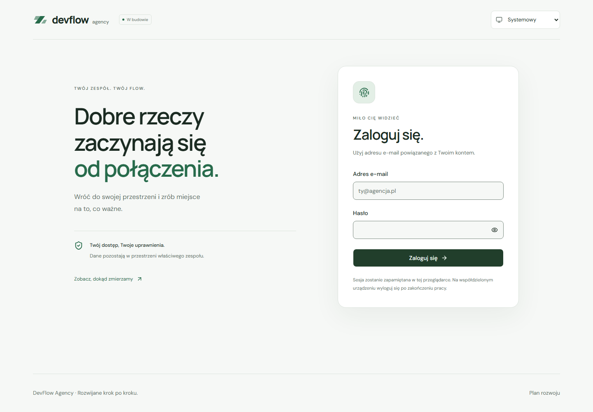

# Logowanie i weryfikowane sesje — ETAP 4, część 1

Gotowe są logowanie e-mailem/hasłem, utrzymanie sesji, ochrona `/app` oraz wylogowanie z bieżącej przeglądarki. To pierwszy z trzech uzgodnionych commitów na dwóch gałęziach. Rejestracja i potwierdzenie e-maila powstaną w drugim commicie; odzyskiwanie konta i profil w trzecim. Google OAuth odłożono decyzją użytkownika. ETAP 4 pozostaje w trakcie.

## Uruchomienie

1. Użyj wspieranej wersji Node z `.node-version`, wykonaj `npm ci` i uzupełnij publiczną konfigurację `.env.local` zgodnie z [instrukcją Supabase](supabase-integration.md). Nie nadpisuj istniejącego pliku.
2. Uruchom `npm run dev` i otwórz adres Vite z dopiskiem `/login`.
3. Zaloguj się istniejącym, potwierdzonym kontem Auth w tym projekcie. **Hasło użytkownika Auth jest odrębne od hasła bazy PostgreSQL.** Formularza zakładania konta jeszcze nie ma.
4. Wejdź na `/app/projects?view=list#route-title`, odśwież stronę i sprawdź zachowanie motywu oraz sesji. Moduły nadal pokazują opisy planowanego zakresu.
5. Wyloguj się przyciskiem w topbarze. Wstecz lub bezpośredni adres `/app` powinien ponownie wymagać logowania.

Bez sesji wejście na prywatny adres kieruje na `/login?returnTo=…`. Po zweryfikowanym logowaniu aplikacja przywraca lokalny adres wraz z parametrami i fragmentem. Niedozwolony cel przekierowania prowadzi do `/app`. Strona powitalna pozostaje dostępna bez konfiguracji; prywatna część przy brakujących zmiennych pokazuje komunikat i przycisk ponowienia.

## Podział odpowiedzialności

| Katalog w `src/features/auth/` | Zakres                                                             |
| ------------------------------ | ------------------------------------------------------------------ |
| `services/`                    | Logowanie, lokalne wylogowanie i obserwowanie tożsamości przez SDK |
| `session/` i `hooks/`          | Provider, context ze stanem i `useAuth`                            |
| `validation/` i `lib/`         | Schemat logowania, bezpieczne komunikaty oraz cel przekierowania   |
| `components/`                  | Formularz, ochrona tras, stan sprawdzania i kontrolki konta        |
| `pages/` i `styles/`           | Ekran `/login` i style oparte na tokenach DevFlow                  |

`AuthProvider` jest ponad routerem. `RequireAuth` otacza wszystkie trasy `/app`, także zagnieżdżone 404. Układ aplikacji otrzymuje kontrolki konta przez slot `accountControls`; wspólne komponenty layoutu nie importują modułu Auth. Formularz i klient są ładowane w osobnych chunkach, aby ograniczyć początkowy bundle.

## Sesja i kontrola dostępu

- SDK zarządza przechowaniem sesji i odświeżaniem tokenów. Context przechowuje stan `loading`, `signed-out`, `signed-in` albo `error`; nie kopiuje tokenów.
- Zapisana sesja i jej pole `user` nie otwierają części prywatnej. Obserwator potwierdza tożsamość przez `auth.getUser(accessToken)` i porównuje identyfikator odpowiedzi z kontem sesji.
- Callback `onAuthStateChange` pozostaje synchroniczny. Dodatkowe wywołanie Auth jest odroczone poza blokadę SDK, co zapobiega zakleszczeniu.
- Numery rewizji i zamknięcie subskrypcji odrzucają spóźnione odpowiedzi po wylogowaniu, zmianie konta lub odmontowaniu. Początkowa weryfikacja i kolejne sprawdzenia mają limit oczekiwania 15 sekund.
- Odmowa Auth, brak użytkownika lub niezgodny identyfikator zamykają prywatny widok i czyszczą lokalną sesję. Po wygaśnięciu aplikacja prosi o ponowne logowanie. Błąd sieci pokazuje stan z ponowieniem bez uznawania zapisanej tożsamości za zweryfikowaną.
- Ponowne sprawdzanie tego samego, wcześniej zweryfikowanego konta zachowuje bieżący widok i fokus. Nieudane sprawdzenie lub przekroczenie czasu zamyka widok; zmiana konta od początku wymaga weryfikacji.
- `signOut({ scope: 'local' })` usuwa sesję z bieżącej przeglądarki. Nie jest funkcją wylogowania wszystkich urządzeń; już wydany access token pozostaje ważny do swojego terminu wygaśnięcia.

Ochrona tras steruje interfejsem. Dostęp do rekordów nadal egzekwują PostgreSQL RLS, granty i aktywne członkostwo w organizacji. Zalogowanie nie nadaje roli w agencji. Nie używamy metadanych użytkownika ani ukrycia przycisku jako autoryzacji. [Macierz dostępu](database-security.md).

Wszystkie `VITE_*` są publiczne. Hasła trafiają wyłącznie do Auth; kod nie zapisuje ich w logach ani własnym storage. Sesje przeglądarkowe są dostępne dla kodu działającego w tym samym origin, dlatego nie wolno dodawać niezaufanych skryptów ani renderować niezaufanego HTML.

## Formularz i dostępność

React Hook Form 7.90.0 z resolverem 5.9.2 używa Zod 4.6.7. Adres e-mail jest przycinany i normalizowany do małych liter. Hasło pozostaje bez zmian, także ze spacjami. Logowanie wymaga niepustego hasła; reguły nowych haseł zostaną określone przy rejestracji, aby nie blokować istniejących kont.

Pola mają etykiety, odpowiednie `autocomplete`, `aria-invalid` i powiązane opisy. Po błędzie walidacji fokus trafia do pierwszego pola; błąd usługi ma `role="alert"` i otrzymuje fokus. Komunikaty pochodzą z jawnej mapy kodów Auth, nigdy z surowego tekstu odpowiedzi. Obsługujemy m.in. nieprawidłowe dane, niepotwierdzony e-mail, limit prób i awarię sieci. Przycisk podglądu hasła ma zmienną dostępną nazwę. Pola i przyciski są blokowane podczas wysyłania.

Po zalogowaniu router aktualizuje tytuł i przenosi fokus do treści docelowej strony. Weryfikacja sesji nie przerywa zwykłych interakcji tego samego konta. Widok wspiera motywy jasny/ciemny/systemowy, klawiaturę, szerokość 320 px i ograniczenie ruchu.

## Weryfikacja i jej granice

```powershell
npm run check
npm run test:e2e
```

Pierwsza część obejmuje 83 testy aplikacji, 100 testów SQL i 98 scenariuszy Playwright na desktopie oraz telefonie. Nowe testy jednostkowe sprawdzają formularz, przekierowania, opóźnione odpowiedzi, zmianę konta, timeouty i odrzucenie zapisanej tożsamości. 18 scenariuszy E2E obejmuje logowanie, sesję po odświeżeniu, wylogowanie, historię, wygaśnięcie, awarię sieci, ponowienie, dostępność i oba motywy. Przejrzano 5 wariantów wizualnych logowania.

`npm run test:e2e` buduje osobny `dist-e2e/` z fikcyjną konfiguracją Auth. Fixture przechwytuje ruch w kontekście przeglądarki i odtwarza odpowiedzi protokołu; jego token i konto są syntetyczne. Testy nie wymagają sekretów, nie kontaktują się z rzeczywistym Supabase i nie tworzą kont. Ten build służy tylko testom i jest ignorowany przez Git.

W developerskim Supabase wykonano dodatkowo jedno logowanie z nieistniejącym adresem: HTTP 400 i `invalid_credentials`, poprawnie mapowane na bezpieczny komunikat. Nie utworzono konta ani nie wysłano maila. Prawidłowe logowanie/JWT/RLS/Storage zweryfikowano przez HTTP w ETAPIE 3; obecne testy przeglądarkowe poprawnego logowania są izolowane. Pełny przepływ zakładania konta, rzeczywistej wiadomości, potwierdzenia i odzyskiwania hasła pozostaje do dalszej części ETAPU 4. Ustawienie potwierdzania e-maila pozostaje włączone. Konta testowe ETAPU 3 pozostawiono zgodnie z decyzją użytkownika.

Automatyczne audyty axe sprawdzają wybrane reguły WCAG A/AA i nie zastępują pełnego audytu dostępności. Ta część nie zmienia schematu bazy, polityk ani konfiguracji produkcyjnej.

## Podgląd



[Ciemny motyw](screenshots/login-dark.png) · [Telefon](screenshots/login-mobile.png) · [Telefon w ciemnym motywie](screenshots/login-mobile-dark.png)

## Źródła

- [Supabase: logowanie hasłem](https://supabase.com/docs/reference/javascript/auth-signinwithpassword).
- [Supabase: weryfikacja użytkownika](https://supabase.com/docs/reference/javascript/auth-getuser).
- [Supabase: zdarzenia sesji](https://supabase.com/docs/reference/javascript/auth-onauthstatechange).
- [Supabase: zakres wylogowania](https://supabase.com/docs/reference/javascript/auth-signout).
- [React Hook Form: useForm](https://react-hook-form.com/docs/useform).
- [Zod: schematy](https://zod.dev/api).
