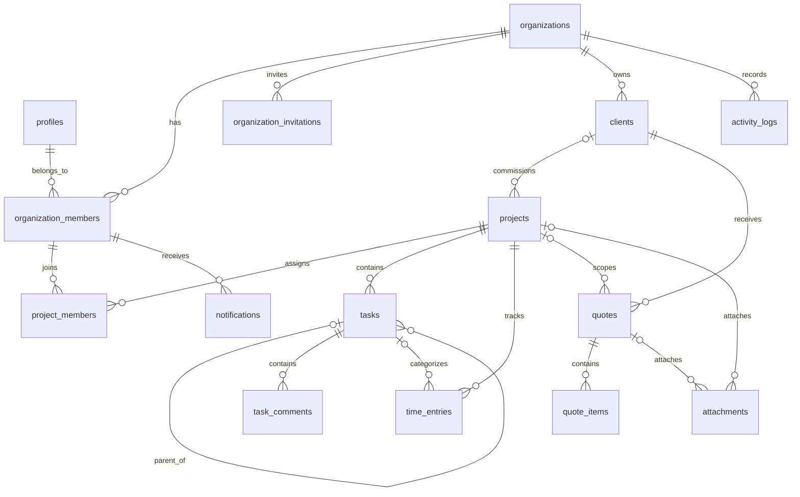

# Baza danych — fundament ETAPU 3

Dwie migracje ETAPU 3 definiują pełny relacyjny model oraz szczegółowe uprawnienia ról i prywatny Storage. Pierwsza tworzy 15 tabel, ograniczenia, indeksy, znaczniki czasu i domyślną odmowę dostępu. Druga nadaje ograniczone uprawnienia, polityki RLS oraz zasobniki plików i awatarów. Nie zostały jeszcze zastosowane do zdalnego projektu. Klient React i końcowa weryfikacja na Supabase należą do trzeciego commita, na drugiej gałęzi. [Macierz dostępu i polityki plików](database-security.md).

## Tabele i odpowiedzialności

| Tabela                     | Odpowiedzialność                                                                    |
| -------------------------- | ----------------------------------------------------------------------------------- |
| `profiles`                 | Dane profilu powiązane z `auth.users`, bez hasła i kopii e-maila                    |
| `organizations`            | Agencja, unikalny slug, waluta i strefa czasowa                                     |
| `organization_members`     | Użytkownik, organizacja, rola, aktywność i opcjonalne powiązanie z klientem         |
| `organization_invitations` | Serwerowe zaproszenie, adres e-mail, skrót tokenu, wygaśnięcie i stan wykorzystania |
| `clients`                  | Dane kontaktowe i firmowe oraz archiwizacja                                         |
| `projects`                 | Klient, status, budżet, waluta, terminy i archiwizacja                              |
| `project_members`          | Członkowie projektu w tej samej organizacji, z aktywnym lub zawieszonym dostępem    |
| `tasks`                    | Projekt, podzadania, status, priorytet, kolejność i przypisanie                     |
| `task_comments`            | Treść, autor i domyślna widoczność wewnętrzna                                       |
| `time_entries`             | Użytkownik projektu, zadanie, przedział czasu, stawka i waluta                      |
| `quotes`                   | Klient, opcjonalny projekt, numer, status, waluta i terminy                         |
| `quote_items`              | Ilość, cena, kolejność i wyliczana w bazie wartość pozycji                          |
| `attachments`              | Metadane pliku projektu, zadania albo wyceny; bez danych binarnych                  |
| `notifications`            | Odbiorca w organizacji, treść i moment odczytania                                   |
| `activity_logs`            | Zdarzenia tworzone przez zaufany kod serwerowy                                      |



Diagram pokazuje główne relacje. Migracja zawiera również autorów, indeksy i złożone klucze obce ograniczające powiązania do jednej organizacji. Każdy załącznik ma dokładnie jeden główny zakres: projekt albo wycenę; plik projektu może dodatkowo wskazać jego zadanie.

## Integralność i dostęp

- Identyfikatory to UUID, a `created_at` i `updated_at` to wymagane `timestamptz` z domyślną wartością. Aktualizacja wiersza ustawia rzeczywisty czas modyfikacji; tożsamość, organizacja i czas utworzenia pozostają niezmienne.
- Klucze obce obejmują `organization_id`, a tam, gdzie potrzeba, również projekt albo klienta. Baza odrzuca np. projekt klienta innej agencji, przypisanie zadania osobie spoza projektu, komentarz do obcego zadania i wycenę klienta innego niż klient projektu.
- Indeksy pokrywają początki wszystkich kluczy obcych. Dodatkowe indeksy obsługują aktywnych klientów i projekty, Kanban, raporty czasu, nieodczytane powiadomienia i historię encji.
- Usuwanie danych z zależnościami jest ograniczone przez `RESTRICT`. Archiwizacja i zawieszenie członkostwa zachowują historię. Usuwanie konta z historią biznesową wymaga przyszłej procedury przeniesienia lub anonimizacji, a nie automatycznego kasowania agencji.
- RLS jest włączone na wszystkich tabelach. Pierwsza migracja cofa uprawnienia `PUBLIC`, `anon` i `authenticated`. Druga przyznaje wybrane operacje oraz dostęp do konkretnych kolumn i wierszy. `anon` nadal nie ma dostępu do tabel aplikacji; konto klienta nie ma jeszcze dostępu do modułów biznesowych.
- `service_role` otrzymuje jawne uprawnienia DML. Jego sekret jest przeznaczony wyłącznie dla zaufanego kodu serwerowego; nie należy do zmiennych `VITE_*`.
- Nowe konto Supabase Auth otrzymuje profil przez trigger; istniejące konta mają backfill. Metadane użytkownika służą wyłącznie do ograniczonej długością nazwy, nigdy do przypisywania roli ani organizacji.
- Funkcje triggerów są w schemacie `private`, mają przypięty pusty `search_path` i cofnięte publiczne uprawnienie wykonania. `private` nie należy do schematów udostępnianych przez Data API.

Role modelu to `owner`, `admin`, `member` i `client`; członkostwo może być aktywne lub zawieszone. Rola klienta wymaga klienta tej samej agencji, pozostałe role go nie przyjmują. Zawieszenie członkostwa w projekcie zachowuje historię i odbiera dostęp zwykłego pracownika do projektu. Właściciel i administrator zachowują dostęp do projektów agencji przez swoją rolę. Nowe przypisanie zadania wymaga aktywnego pracownika organizacji i projektu. Tworzenie organizacji, zaproszenia, przyjmowanie członków i ochrona ostatniego właściciela należą do ETAPU 5; bezpośrednie zapisy członkostwa pozostają niedostępne z przeglądarki.

## Reguły modułów przygotowane w schemacie

Podzadanie musi należeć do projektu rodzica i nie może utworzyć cyklu. Zmiany drzewa używają blokady transakcyjnej projektu. Testy PGlite sprawdzają cykle w pojedynczym połączeniu; testy wielu jednoczesnych połączeń wymagają pełnego PostgreSQL.

Jeden użytkownik może mieć jeden uruchomiony timer także przy członkostwie w wielu agencjach. Zakończony przedział wymaga końca późniejszego od początku. Walidacja nakładających się zakończonych wpisów, reguły start/stop i raporty należą do ETAPU 10.

Kwoty i ilości korzystają z `numeric`, a nie z liczb zmiennoprzecinkowych. Pozycja wyceny oblicza `round(quantity * unit_price, 2)` jako kolumnę generowaną. Nie przyjmuje ręcznego nadpisania sumy. Uzgodnienie podatków, sum wyceny, numeracji i przejść statusu pozostaje w ETAPIE 11. Ograniczenia odrzucają ujemne wartości, `NaN` i nieskończoność w polach pieniężnych oraz ilościowych.

Zaproszenie zapisuje wyłącznie 32-bajtowy skrót SHA-256 tokenu. Surowy token zostanie wygenerowany i wysłany przez przyszłą logikę serwerową. Kolejne zaproszenie pod ten sam adres wymaga unieważnienia poprzedniego niewykorzystanego zaproszenia, także wygasłego.

Załącznik ma rozmiar do 20 MiB i generowaną ścieżkę `organization_id/attachment_id` w prywatnym buckecie `agency-files`. Nazwa wyświetlana nie staje się ścieżką obiektu. Sam zapis metadanych nie oznacza przesłania pliku. Druga migracja dodaje polityki Storage i prywatny bucket `avatars` do 2 MiB; faktyczny upload HTTP zostanie zweryfikowany przy integracji. [Szczegóły](database-security.md).

## Odtwarzalne testy

```powershell
npm ci
npm run test:db
npm run check
```

`test:db` używa Node test runner i PGlite 0.5.10 (PostgreSQL 18.6 w WebAssembly). Uruchamia rzeczywiste, nieprzepisywane migracje SQL na izolowanej bazie w pamięci, tworzy dane testowe i zamyka bazę po przebiegu. Nie używa `.env.local`, sieci ani projektu użytkownika. PGlite jest tylko zależnością developerską; nie trafia do aplikacji ani nie zastępuje Supabase.

Fixture `supabase/tests/fixtures/bootstrap.sql` definiuje minimalny kontrakt testowy `auth.users`, `auth.uid()`, ról i tabel Storage. Nie jest migracją i nie wolno wykonywać go na Supabase. Testy ustawiają kontekst użytkownika na potrzeby SQL; nie walidują podpisu JWT ani usług HTTP. Sprawdzają klucze obce, triggery, granty i RLS, ale nie fizyczne pliki, Auth HTTP, Storage HTTP ani współbieżne połączenia. Konfiguracja lokalnego Supabase używa PostgreSQL 17; ostateczna weryfikacja na docelowym Supabase nastąpi przy integracji.

Łącznie 100 testów obejmuje 38 testów schematu i opcjonalnego seed oraz 62 testy kompletnej migracji uprawnień, Storage i zgodności seed z całym łańcuchem. Pierwszy zestaw odtwarza stan po pierwszej migracji; drugi uruchamia cały łańcuch. Sprawdzają poprawne operacje i odmowy, osiem kontekstów ról, brak tożsamości, obce organizacje i projekty, zawieszenie i zmianę ról, pola chronione oraz pliki. `npm run check` obejmuje także testy bazy. Zmiany nie dodają jeszcze interfejsu modułów ani logowania.

Pełne lokalne Supabase na Windows wymaga Supabase CLI i zgodnego środowiska kontenerów, np. Docker Desktop. Nie jest wymagane do uruchomienia obecnych testów PGlite. CLI i zastosowanie migracji do projektu developerskiego zostaną przygotowane po sprawdzeniu kolejnej migracji bezpieczeństwa.

## Opcjonalne dane developerskie

`supabase/seed.sql` jest wyłączony w `config.toml`. Nie jest uruchamiany podczas migracji ani testów aplikacji. Wymaga istniejącego profilu Auth, ustawienia `devflow.environment=development` i `devflow.seed_user_id` w tej samej sesji SQL. Nie tworzy kont, haseł ani użytkowników demonstracyjnych. Dodaje jedną agencję, klienta, projekt i zadanie oznaczone `[DEMO]`; ponowne uruchomienie odrzuca nadpisanie danych.

Przykład dla świadomie wybranego, wyłącznie developerskiego środowiska, w jednej sesji administracyjnej:

```sql
set devflow.environment = 'development';
set devflow.seed_user_id = 'UUID_ISTNIEJACEGO_PROFILU_AUTH';
-- Następnie wykonaj supabase/seed.sql w tej samej sesji.
```

Te ustawienia są zabezpieczeniem przed pomyłką, nie mechanizmem uprawnień ani rozpoznawania produkcji. Nie uruchamiaj seed na środowisku produkcyjnym. Dane fixture testów są oddzielne od tego opcjonalnego seed.

## Źródła

- [Supabase — migracje i workflow](https://supabase.com/docs/guides/local-development/database-migrations).
- [Supabase — RLS, granty i funkcje security definer](https://supabase.com/docs/guides/database/postgres/row-level-security).
- [Supabase — testowanie bazy](https://supabase.com/docs/guides/database/testing).
- [PGlite — uruchamianie PostgreSQL w pamięci](https://pglite.dev/docs/).
