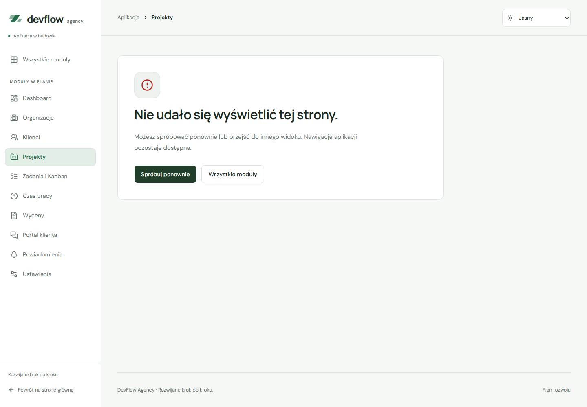

# Obsługa błędów interfejsu

Przygotowano wspólny `ErrorState` oraz dwie granice błędów renderowania z [react-error-boundary](https://github.com/bvaughn/react-error-boundary) 6.1.6. Pakiet jest zgodny z Reactem 19; wersja i lockfile są przypięte. Komponenty aplikacji pozostają funkcyjne.

## Błąd całej aplikacji

`ApplicationErrorBoundary` w `src/app/main.tsx` obejmuje `App`, jego providery, router i toasty. Gdy błąd renderowania dotrze do tej granicy, użytkownik otrzyma komunikat, przycisk „Spróbuj ponownie” i link „Strona główna”.

Ekran awaryjny działa bez kontekstu routera i motywu. Używa istniejących tokenów CSS oraz motywu ustawionego przed Reactem przez `theme-init.js`. Link do strony głównej jest natywny i wczytuje dokument od nowa. Ponowienie resetuje granicę i próbuje jeszcze raz wyrenderować aplikację; nie usuwa przyczyny błędu. Jeśli przyczyna pozostaje, komunikat nadal jest dostępny.

## Błąd pojedynczej strony

`PageErrorBoundary` obejmuje `Outlet` w `AppLayout` i `RouteLayout`. Awaria strony pozostawia dostępną nawigację, nagłówek i toasty. Można ponowić renderowanie albo przejść do innego widoku.

Zmiana `pathname` tworzy nową granicę dla wybranej strony, dzięki czemu błąd poprzedniego modułu nie blokuje nawigacji. Sama zmiana parametrów zapytania lub fragmentu URL nie resetuje błędu. Granica strony nie obejmuje sidebara ani topbara; ich błędy renderowania przejmuje granica całej aplikacji.

Oba ekrany awaryjne ustawiają tytuł dokumentu i przenoszą fokus do `main`. Po udanym ponowieniu tytuł oraz fokus wracają do odzyskanej treści. Zwykła nawigacja nadal korzysta z `RouteEffects`; wspólna funkcja tytułu znajduje się w `src/app/page-title.ts`.

Komunikaty użytkownika są stałymi tekstami. Nie pokazują treści wyjątku, stosu, nazw plików ani odpowiedzi serwera. Nie dodano zewnętrznej telemetrii; natywna diagnostyka Reacta w konsoli nie jest systemem monitorowania projektu.

## Błąd wewnątrz widoku

`ErrorState` jest komponentem prezentacyjnym, przygotowanym również dla przyszłych wyników zapytań:

```tsx
import { ErrorState } from '@/components/shared/error-state'

;<ErrorState
  title="Nie udało się pobrać wyników."
  description="Sprawdź połączenie i spróbuj ponownie."
  onRetry={retryQuery}
/>
```

Domyślny poziom nagłówka to `h2`. `headingLevel={3}` pasuje do podsekcji, a `headingLevel={1}` do całej strony. Opcjonalne `headingId` pozwala powiązać nagłówek z istniejącym `main`. Bez `onRetry` nie ma przycisku ponowienia; `children` mogą zawierać właściwe linki lub inne akcje. Tytuł, opis oraz identyfikatory domyślne są powiązane semantycznie i unikalne dla instancji.

Komponent nie wykonuje zapytań, nie odczytuje wyjątku i nie zmienia samodzielnie fokusu. Nie dodaje też automatycznego `role="alert"`; ekrany awaryjne przekazują kontekst przez fokus. Moduł prezentujący dynamiczny wynik zapytania powinien odpowiednio ogłosić zmianę lub przenieść fokus, bez powielania tego samego komunikatu.

## Zakres granic i dalszych modułów

Granice Reacta obsługują błędy renderowania ich potomków. Zwykłe handlery zdarzeń, obietnice wykonywane poza renderowaniem i callbacki timerów wymagają własnej obsługi. [Zakres Error Boundary w dokumentacji React](https://react.dev/reference/react/Component#catching-rendering-errors-with-an-error-boundary).

Przyszłe formularze i zapytania powinny obsługiwać oczekiwany błąd przy właściwej treści i pokazywać bezpieczny komunikat. Toast może uzupełnić informację o wyniku operacji. Nie należy polegać na granicy renderowania jako obsłudze nieudanego żądania ani ignorować odrzuconych obietnic.

Plik JavaScript, który nie został pobrany lub uruchomiony, nie może sam wyrenderować granicy Reacta. Ten zakres nie obejmuje też błędu przed utworzeniem korzenia Reacta. Nie dodano demonstracyjnych awarii, adresów testowych ani pobierania z fikcyjnego API do aplikacji.

## Kontrole i podgląd

```powershell
npm test -- src/app/errors/error-boundaries.test.tsx
npm run check
npm run test:e2e
```

Pięć testów sprawdza ekran bez providerów, bezpieczną treść, ponowienie klawiaturą, trwałą przyczynę błędu, zachowanie nawigacji i toastów, przejście do innego modułu oraz odzyskanie tytułu i fokusu. Aktualny pełny zestaw: 27 testów React i 76 scenariuszy E2E.

Odizolowany podgląd wywoływał kontrolowany błąd w rzeczywistych komponentach. Sprawdzono awarię aplikacji i pojedynczej strony w pięciu wariantach: jasny i ciemny desktop 1440 px, tablet 768 px, telefon 390 px i mały ekran 320 px — łącznie 10 widoków. Ponowienie, nawigacja, menu mobilne, fokus, tytuły, motywy oraz brak przepełnienia działały poprawnie. Axe nie wykrył naruszeń sprawdzanych reguł WCAG A/AA. To osobna kontrola komponentów, poza zestawem E2E aplikacji, bez dodatkowej trasy produktu. Nie zastępuje pełnego audytu z czytnikiem ekranu.



[Awaria aplikacji — ciemny motyw](screenshots/error-app-dark.png) · [Mały ekran](screenshots/error-page-mobile.png)
