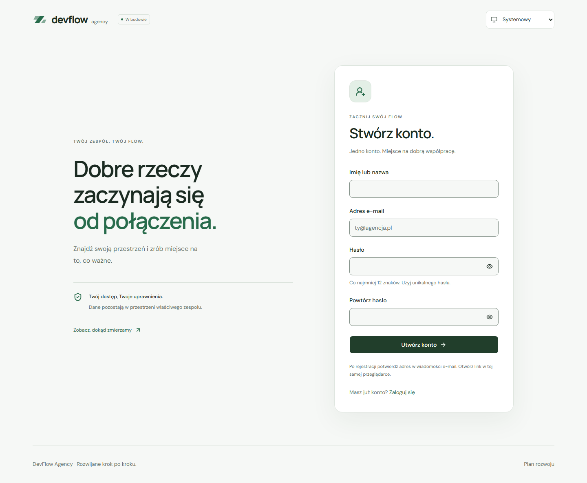

# Rejestracja i potwierdzenie e-maila — ETAP 4, część 2

Drugi zakres na `feat/authentication` dodaje rejestrację, ekran sprawdzania poczty, ponowną wysyłkę i jawny callback PKCE. Commity `a42bb25` i `1d2942e` zostały wypchnięte przez użytkownika. Hasła, linki i tokeny nie trafiają do repozytorium. Odzyskiwanie konta i profil opisano w [trzeciej części](account-management.md) na `feat/account-management`. Google OAuth jest odłożony.

## Adresy i zachowanie

| Adres           | Zachowanie                                                                                         |
| --------------- | -------------------------------------------------------------------------------------------------- |
| `/register`     | Imię/nazwa, e-mail, hasło i jego powtórzenie; po przyjętej prośbie przejście do sprawdzenia poczty |
| `/check-email`  | Neutralna informacja i formularz ponownej wysyłki potwierdzenia                                    |
| `/auth/confirm` | Oczyszczenie adresu i wymiana kodu PKCE po kliknięciu „Dokończ logowanie”                          |
| `/login`        | Logowanie oraz linki do rejestracji i ponownego potwierdzenia                                      |

`returnTo` przechodzi między formularzami i do adresu powrotu, ale dopuszcza wyłącznie lokalne trasy `/app`. Ponowne sprawdzenie odbywa się w serwisie, więc zewnętrzny URL nie trafia do wiadomości. Adres e-mail po rejestracji jest przekazywany przez stan routera, a nie parametry URL. Formularz potwierdzenia pozwala ponownie wpisać adres, jeśli stan nie jest dostępny.

Rejestracja normalizuje nazwę i e-mail. Hasło ma 12–128 znaków i pozostaje bez przycinania; powtórzenie musi być zgodne. Serwer może wymagać dodatkowych reguł. Powtórzone hasło nie jest wysyłane do Auth. Metadane obejmują wyłącznie `display_name`; istniejący trigger tworzy profil bez roli i członkostwa w organizacji. Role nadal wynikają z bazy i RLS.

Odpowiedzi dla już istniejącego konta nie ujawniają tego w interfejsie. Przyjęta prośba nie jest gwarancją dostarczenia wiadomości. Błąd serwera nie jest pokazywany jako sukces. Pola i przyciski są blokowane podczas żądania; błędy mają opisy, ogłoszenie i fokus.

Po rejestracji oraz każdej próbie ponownej wysyłki interfejs odlicza 60 sekund. Termin jest zapisywany w `sessionStorage`, bez adresu e-mail, hasła lub kodu, i przetrwa odświeżenie karty. To ułatwienie interfejsu; rzeczywiste limity egzekwuje Supabase. Blokada storage nie blokuje formularza ani obsługi błędów serwera.

## Callback i bezpieczeństwo

SDK używa PKCE i przechowuje weryfikator w przeglądarce. Wiadomość powinna prowadzić do standardowego `{{ .ConfirmationURL }}` z szablonu Supabase. Po potwierdzeniu usługa przekierowuje na `/auth/confirm` z jednorazowym kodem. Wymiana wymaga tej samej przeglądarki i urządzenia, w których rozpoczęto przepływ; kod Auth ma krótki termin ważności. [Supabase: PKCE](https://supabase.com/docs/guides/auth/sessions/pkce-flow).

Automatyczne wykrywanie sesji z URL pozostaje wyłączone. Callback:

- Przyjmuje wyłącznie jednoznaczny kod PKCE i opcjonalny, zwalidowany `sb_flow_id`, przekazywany do SDK bez szukania innego weryfikatora.
- Odrzuca access/refresh tokeny z URL, hashe OTP i linki oznaczone jako odzyskiwanie hasła. Osobny przepływ recovery działa pod `/auth/recovery` w trzeciej części.
- Zachowuje niewykorzystany kod w adresie do próby wymiany, aby odświeżenie przed kliknięciem nie gubiło linku. Po próbie usuwa dane przez przekierowanie lub oczyszczenie adresu. Nie zapisuje kodu we własnym storage; dokument ma politykę `no-referrer`. Błędne parametry i surowe szczegóły błędów usuwa od razu.
- Wymienia kod dopiero po kliknięciu, dzięki czemu samo otwarcie strony i ponowne efekty React StrictMode nie zużywają kodu.
- Nie zastępuje automatycznie już zalogowanego konta. Aktywna sesja pokazuje odnośnik do własnej aplikacji i instrukcję wylogowania przed użyciem innego konta.
- Po wymianie czeka na osobną weryfikację użytkownika przez providera. Sama odpowiedź wymiany nie otwiera prywatnej części. Jeżeli sesja jeszcze nie jest aktywna, przechodzi przez logowanie; nie opisuje udanej wymiany jako błędnego linku.
- Pokazuje bezpieczny komunikat dla linku nieprawidłowego, użytego, wygasłego lub otwartego bez weryfikatora. Proponuje logowanie hasłem albo nową wiadomość, bez nieskończonego ponawiania jednorazowego kodu.

Przy błędzie wymiany SDK może usunąć weryfikator. Nie obiecujemy ponowienia tego samego linku po awarii sieci. Odświeżenie oczyszczonej strony także wymaga ponownego otwarcia najnowszego linku albo logowania hasłem. Jeżeli samo potwierdzenie adresu już nastąpiło, brak sesji w innej przeglądarce nie wymaga zakładania konta od nowa.

## Konfiguracja developerska

1. Wybierz **developerski** projekt w Supabase, następnie **Authentication → URL Configuration**.
2. Ustaw Site URL: `http://127.0.0.1:5173`.
3. Dodaj Redirect URLs:

```text
http://127.0.0.1:5173/auth/confirm**
http://localhost:5173/auth/confirm**
```

4. Zapisz zmiany. Wzorzec obejmuje parametry celu i opcjonalny identyfikator przepływu; nie dodawaj szerokiego wzorca dla obcych domen. W środowisku produkcyjnym adresy wymagają osobnej konfiguracji przy wdrożeniu.
5. Pozostaw włączone potwierdzanie e-maila i standardowy link `{{ .ConfirmationURL }}` w szablonie potwierdzenia.

Użytkownik potwierdził zapisanie Site URL i obu adresów w panelu projektu developerskiego. Agent nie miał zalogowanego panelu w dostępnej przeglądarce, więc nie deklaruje niezależnego odczytu tych ustawień. Sam plik `supabase/config.toml` dotyczy lokalnego CLI i nie zmienia zdalnego projektu. Lokalnie także jawnie włączono potwierdzanie e-maila. [Dozwolone adresy powrotu](https://supabase.com/docs/guides/auth/redirect-urls).

Domyślna poczta Supabase jest przeznaczona do prób developerskich. Bez własnego SMTP wysyła wyłącznie na adresy członków organizacji projektu i ma niski limit wiadomości (według dokumentacji w dniu weryfikacji: 2 na godzinę). Do testu użyj własnego adresu konta w tej organizacji. Publiczna rejestracja dla dowolnych odbiorców wymaga konfiguracji SMTP. Nie wyłączaj potwierdzania e-maila, aby ominąć problem z dostarczeniem. [Dokumentacja SMTP i ograniczenia](https://supabase.com/docs/guides/auth/auth-smtp).

## Rzeczywista próba użytkownika

```powershell
npm run dev -- --port 5173 --strictPort
```

Otwórz `http://127.0.0.1:5173/register` i użyj własnego adresu uprawnionego do odbioru poczty. Wybierz odrębne, nowe hasło dla aplikacji. Po rejestracji sprawdź skrzynkę i spam. Otwórz najnowszy link w tej samej przeglądarce oraz kliknij „Dokończ logowanie”. Sprawdź przejście do aplikacji, odświeżenie i wylogowanie.

Nie przesyłaj hasła, pełnego linku ani kodu do czatu. Jeśli wystąpi problem, wystarczy bezpieczny komunikat widoczny na stronie. Adres `localhost` i `127.0.0.1` to różne originy storage: podczas jednej próby trzymaj się adresu wyświetlonego powyżej. Gdy port jest zajęty, użyj działającego już serwera albo zatrzymaj własny serwer w jego terminalu; nie zmieniaj portu bez dopisania dozwolonego adresu w Supabase.

Użytkownik wykonał rzeczywistą rejestrację, otrzymał wiadomość i potwierdził adres; odczyt administracyjny potwierdził utworzenie oraz akceptację konta bez odczytywania hasła i kodu. Po kliknięciu dokończenia logowania zobaczył błędny stan linku, a następnie poprawnie zalogował się hasłem i potwierdził dostęp do aplikacji. Po tej próbie poprawiono zachowanie odświeżenia przed wymianą oraz przejście do logowania, gdy sesja po wymianie nie jest jeszcze aktywna. Poprawki sprawdzono automatycznie; automatycznej sesji po nowej rzeczywistej wiadomości nie sprawdzono ponownie. Końcowa weryfikacja ETAPU 4 musi zachować to rozróżnienie.

Agent w tej części nie wysyłał maili ani nie tworzył zdalnych kont. Dotychczasowe fixture ETAPU 3 pozostają zgodnie z wcześniejszą decyzją użytkownika.

## Testy automatyczne

- `npm run check`: lint, formatowanie, typy, 116 testów aplikacji, 100 testów SQL, zgodność generatora i produkcyjny build; kod zakończenia 0.
- `npm run test:e2e`: 120 scenariuszy na desktopie i telefonie; kod zakończenia 0. Nowe 22 przebiegi obejmują rejestrację, walidację, PKCE, resend i odliczanie, ponowne użycie, brak weryfikatora, błędy linków i limity wysyłki.
- Fixture porównuje SHA-256 weryfikatora wysłanego przez SDK z wyzwaniem otrzymanym przy rejestracji lub resend oraz odmawia ponownej wymiany. Nie jest rzeczywistą usługą Auth ani kontrolą dostarczenia poczty.
- `npm run supabase:verify`: 16 odczytowych kontroli zdalnego Auth i anonimowej odmowy wszystkich tabel, bez zapisów.
- 11 wariantów wizualnych: logowanie, rejestracja, sprawdzenie poczty oraz poprawny i błędny callback, oba motywy i szerokości 320–1440 px. Brak błędów wykonania i poziomego przepełnienia; audyty axe wybranych reguł WCAG A/AA nie zastępują pełnego audytu.

Nie zmieniono migracji ani RLS. Odzyskiwanie hasła, jego zmiana, profil i awatar nie należą do tego commita.

## Podgląd



[Ciemny motyw](screenshots/register-dark.png) · [Telefon](screenshots/register-mobile.png) · [Sprawdzenie poczty](screenshots/check-email-mobile.png) · [Callback](screenshots/confirm-ready-dark.png) · [Błędny link](screenshots/confirm-error-mobile.png)
