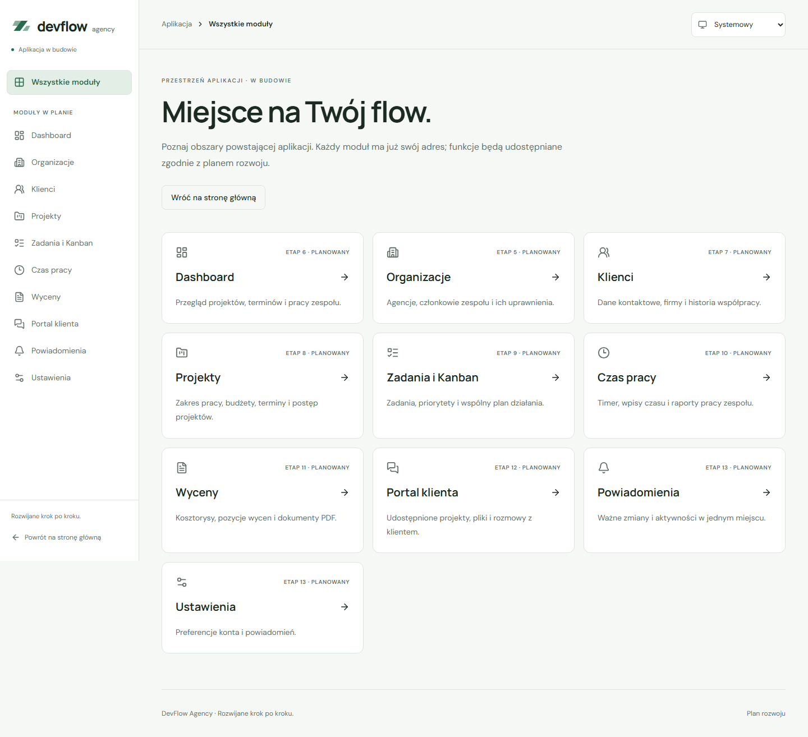

# Routing aplikacji

Aplikacja korzysta z `react-router` 8.4.0 w trybie deklaratywnym: `BrowserRouter`, `Routes`, zagnieżdżone `Route`, `Outlet` i `Link`. [Instalacja](https://reactrouter.com/start/declarative/installation) · [Konfiguracja tras](https://reactrouter.com/start/declarative/routing).

## Adresy

| Adres                | Widok                                                  | Planowany etap funkcji |
| -------------------- | ------------------------------------------------------ | ---------------------- |
| `/`                  | Publiczny ekran powitalny, katalog i plan rozwoju      | Ekran dostępny         |
| `/login`             | Publiczny formularz logowania e-mailem i hasłem        | 4, dostępny            |
| `/register`          | Publiczny formularz rejestracji                        | 4, dostępny            |
| `/check-email`       | Instrukcja potwierdzenia i ponowna wysyłka             | 4, dostępny            |
| `/auth/confirm`      | Jawna obsługa kodu PKCE i błędów linku                 | 4, dostępny            |
| `/app`               | Lista obszarów aplikacji                               | Lista dostępna         |
| `/app/dashboard`     | Dashboard                                              | 6                      |
| `/app/organizations` | Organizacje                                            | 5                      |
| `/app/clients`       | Klienci                                                | 7                      |
| `/app/projects`      | Projekty                                               | 8                      |
| `/app/tasks`         | Zadania i Kanban                                       | 9                      |
| `/app/time-tracking` | Czas pracy                                             | 10                     |
| `/app/quotes`        | Wyceny                                                 | 11                     |
| `/app/client-portal` | Portal klienta                                         | 12                     |
| `/app/notifications` | Powiadomienia                                          | 13                     |
| `/app/settings`      | Ustawienia                                             | 13                     |
| Pozostałe adresy     | Strona 404 z linkami do strony głównej i listy modułów | Widok dostępny         |

Wszystkie adresy `/app` wymagają sesji zweryfikowanej przez Supabase Auth. Bez niej następuje przekierowanie do `/login` z bezpiecznym powrotem do pierwotnego adresu. Podczas weryfikacji i błędu sieci prywatny układ pozostaje ukryty; błąd umożliwia ponowienie. Adresy modułów nadal pokazują opisy i informację „Ten moduł jest w planie”. Nieznany adres wewnątrz modułu, np. `/app/projects/unknown`, po zalogowaniu pokazuje 404. [Architektura logowania](authentication.md).

## Struktura

- `src/app/app.tsx`: wspólne `ThemeProvider`, `AuthProvider` i `BrowserRouter`.
- `src/app/app-routes.tsx`: ekrany publiczne, `RequireAuth`, zagnieżdżone trasy `/app` we wspólnym układzie i fallbacki nieznanych adresów.
- `src/app/app-modules.ts`: nazwy, ścieżki, opisy, ikony i planowane etapy obszarów.
- `src/app/pages/`: lista obszarów, wspólny podgląd planowanego modułu i strona 404.
- `src/components/layout/app-layout.tsx`: sidebar, topbar, lewe menu mobilne, skip link, jeden `main` i stopka dla `/app` oraz jego nieznanych adresów. [Szczegóły układu](app-shell.md).
- `src/components/layout/route-layout.tsx`: prosty nagłówek, główna treść i stopka logowania, globalnej strony 404 oraz stanów weryfikacji sesji.
- `src/app/route-effects.tsx`: tytuł dokumentu i obsługa fokusu oraz przewijania między stronami.
- `src/styles/routes.css` i `src/styles/app-shell.css`: style stron i układu we wspólnej palecie.

Logika i widoki rzeczywistych modułów powstaną w odpowiednich katalogach `features/`. Obecny wspólny podgląd nie zastępuje ich implementacji.

## Nawigacja i dostępność

Link „Zobacz moduły aplikacji” prowadzi ze strony powitalnej do `/app`; bez sesji otwiera się logowanie. Przejścia między stronami używają `Link`, zachowując natywną semantykę linku i działanie historii. Provider motywu pozostaje zamontowany ponad routerem. Po poprawnym logowaniu wymagamy dodatkowo zweryfikowanej tożsamości przed wejściem do prywatnego układu. `returnTo` dopuszcza wyłącznie znormalizowane lokalne ścieżki `/app` i `/app/…`.

Po zmianie ścieżki aktualizuje się tytuł dokumentu, fokus trafia do głównej treści, a strona przewija się na początek. Link do istniejącej kotwicy na innej stronie, np. `/#plan-rozwoju`, przekazuje fokus do sekcji i przewija do niej. Początkowe wejście bez kotwicy zachowuje zwykły fokus przeglądarki. Zmiany samej kotwicy na stronie powitalnej pozostają obsługiwane przez natywne linki i panel mobilny. Nieprawidłowy zapis kodowania fragmentu URL nie przerywa renderowania.

Skip link, jeden `main`, jeden nagłówek `h1` oraz etykietowany wybór motywu występują również na stronie 404. O zarządzaniu fokusem podczas nawigacji SPA: [React Router — dostępność](https://reactrouter.com/how-to/accessibility).

## Uruchomienie i sprawdzenie

```powershell
npm run dev
```

Użyj adresu wyświetlonego przez Vite, następnie:

1. Otwórz `/`, kliknij „Zobacz moduły aplikacji”, zaloguj się istniejącym kontem Auth i wybierz moduł.
2. Sprawdź Wstecz, Dalej i zachowanie wybranego motywu.
3. Otwórz bezpośrednio `/app/projects` i odśwież stronę.
4. Otwórz `/brak-strony` i sprawdź linki powrotu.
5. W podglądzie modułu wybierz „Zobacz plan rozwoju”; fokus powinien trafić do sekcji roadmapy.

Testy routingu:

```powershell
npm test -- src/app/app-routes.test.tsx
npm run test:e2e -- e2e/routing.spec.ts
```

Aktualny pełny zestaw obejmuje 116 testów aplikacji, 100 testów SQL i 120 scenariuszy E2E. Testy routingu wybierają izolowany stan zalogowany; osobne testy uwierzytelniania sprawdzają odmowę dostępu, bezpieczny powrót i wylogowanie. Regresja nadal obejmuje dziesięć adresów modułów, odświeżanie, historię, nawigację bez przeładowania, motyw, tytuły, fokus, kotwice, nieznane adresy i nieprawidłowy fragment URL. Audyty axe na liście obszarów, podglądzie modułu, stronie 404 i otwartym menu aplikacji przeszły w obu motywach na desktopie i telefonie. Sprawdzono też skip link, aktywne linki, krótkie ekrany i szerokość 320 px.

Bezpośrednie adresy i odświeżanie sprawdzono na lokalnym podglądzie Vite. Obecne E2E automatycznie buduje `dist-e2e` z izolowaną konfiguracją i odpowiedziami Auth, bez używania rzeczywistego projektu. W ETAPIE 15 zweryfikujemy konfigurację hostingu Vercel i odpowiedzi HTTP. Obecne 404 jest widokiem routera w aplikacji SPA, nie serwerowym statusem HTTP 404. Automatyczne testy dostępności nie zastępują pełnego audytu.

## Zrzuty



[Ciemny motyw](screenshots/routes-dark.png) · [Moduł na telefonie](screenshots/route-module-mobile.png) · [Strona 404](screenshots/not-found-mobile.png)
