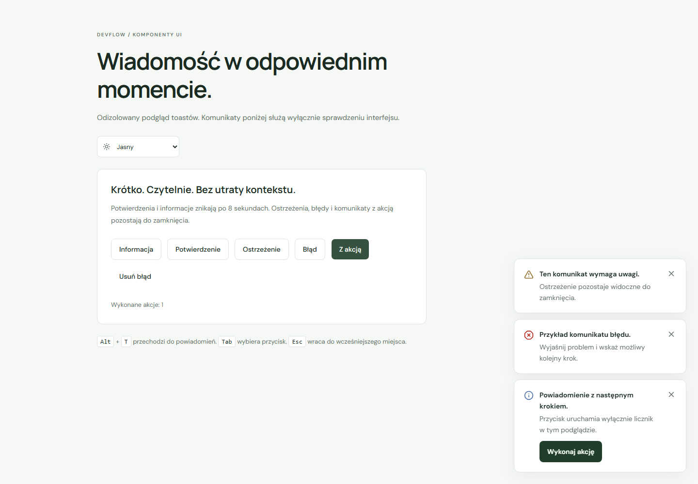

# Krótkie powiadomienia

`Toaster` z `src/components/ui/sonner.tsx` jest adaptacją komponentu [shadcn/ui Sonner](https://ui.shadcn.com/docs/components/radix/sonner). Korzysta z Sonner 2.0.8, zgodnego z Reactem 19. Pakiet nie deklaruje dodatkowego wymagania `engines`; aplikacja nadal wymaga Node określonego w `package.json`.

Jedna instancja znajduje się w `App`, pod providerem motywu i poza routerem. Zmiana trasy nie odmontowuje powiadomień. Na obecnych ekranach nie ma operacji zapisu do backendu ani przycisków demonstracyjnych. Moduły będą wywoływały powiadomienia po rzeczywistych operacjach w kolejnych etapach. To infrastruktura interfejsu; trwałe powiadomienia użytkownika są osobnym zakresem ETAPU 13.

## Użycie

Wywołuj wspólne API z `src/lib/notify.ts`:

```tsx
import { dismissNotification, notify } from '@/lib/notify'

// Dopiero po pomyślnym zakończeniu rzeczywistej operacji:
notify('Zapisano zmiany.', { kind: 'success' })

notify('Nie udało się zapisać zmian.', {
  kind: 'error',
  description: 'Sprawdź połączenie i spróbuj ponownie.',
})

const id = notify('Możesz wrócić do przeglądu.', {
  action: { label: 'Otwórz przegląd', onClick: openOverview },
})

// Jawne zamknięcie konkretnego powiadomienia:
dismissNotification(id)
```

| Opcja         | Zachowanie                                                       |
| ------------- | ---------------------------------------------------------------- |
| `kind`        | `info` domyślnie; także `success`, `warning` i `error`           |
| `description` | Opcjonalny opis tekstowy                                         |
| `id`          | Tekst lub liczba; powtórne wywołanie aktualizuje jeden komunikat |
| `action`      | Jedna akcja z tekstową etykietą i funkcją `onClick`              |

`notify` zwraca identyfikator. Aktualizacja przez ten sam `id` zastępuje tytuł, opis, rodzaj i akcję; pominięcie opisu lub akcji usuwa poprzednie wartości. Powiadomienia pozostają wyłącznie w pamięci bieżącej strony. Odświeżenie je usuwa.

Informacje i potwierdzenia znikają po 8 sekundach. Ostrzeżenia, błędy oraz każdy komunikat z akcją pozostają do zamknięcia. Akcja wywołuje funkcję jeden raz dla danego naciśnięcia i zamyka toast; nie zastępuje walidacji, obsługi błędów ani blokady równoległych operacji we właściwym module. Nie przekazuj surowych wyjątków i odpowiedzi serwera jako treści użytkownika. Błędy formularzy i problemy wymagające trwałego wyjaśnienia powinny mieć również opis przy właściwej treści.

## Klawiatura i wygląd

- Region „Powiadomienia (Alt+T)” używa `aria-live="polite"`. Pojawienie się komunikatu nie przenosi fokusu.
- `Alt+T` przenosi fokus do listy i rozwija stos. Odliczanie jest wtedy wstrzymane; wstrzymuje je również najechanie wskaźnikiem.
- `Tab` wybiera kartę, następnie przycisk zamknięcia i opcjonalną akcję. `Enter` uruchamia wybrany przycisk.
- `Escape` wraca do poprzednio aktywnego elementu i pozwala Sonnerowi wznowić odliczanie. Samo `Escape` nie usuwa komunikatu.
- Przycisk „Zamknij powiadomienie” oraz akcja mają co najmniej 44 px. Dekoracyjne ikony są ukryte przed czytnikami ekranu.
- Domyślny stos znajduje się na dole po prawej. Sonner pokazuje maksymalnie trzy karty; starsze czekają do zwolnienia miejsca. Ukryte karty nie trafiają do kolejności tabulacji.
- Na telefonie obowiązują odstępy 16 px z uwzględnieniem bezpiecznych krawędzi. Tekst zawija się, a animacje respektują ograniczenie ruchu.

`src/styles/toasts.css` korzysta z tokenów DevFlow, w tym jasnej i ciemnej powierzchni, tekstu oraz fokusu. Importuje go centralnie `globals.css`. Jest to świadomie ograniczony selektorami adapter bez warstwy CSS: Sonner wstrzykuje własne style bez warstwy. Wariant `unstyled` pozwala ustalić układ kart i większe przyciski, a zmienne adaptera ujednolicają także domyślne style ciemnego motywu biblioteki.

## Weryfikacja i podgląd

```powershell
npm test -- src/components/ui/sonner.test.tsx
npm run check
npm run test:e2e
```

Testy React sprawdzają aktualizację bez duplikatu, usuwanie poprzedniej akcji i opisu, wykonanie akcji, brak automatycznej zmiany fokusu, skrót, zamknięcie klawiaturą, powrót fokusu i zmianę motywu. Aktualny pełny zestaw aplikacji obejmuje 22 testy React i 76 scenariuszy E2E.

Osobny podgląd prawdziwych komponentów sprawdzono w pięciu wariantach: jasny i ciemny desktop 1440 px, tablet 768 px, telefon 390 px oraz mały ekran 320 px. Kontrole objęły czas wyświetlania i jego wstrzymanie, trwałe komunikaty, aktualizację, akcję, klawiaturę, motyw ręczny i systemowy, granice ekranu, 44-pikselowe przyciski oraz axe w obu motywach. Nie wykryto naruszeń sprawdzanych reguł WCAG A/AA ani błędów wykonania. Podgląd nie jest trasą aplikacji. Kontrole automatyczne nie zastępują pełnego audytu z czytnikiem ekranu.



[Ciemny motyw](screenshots/toasts-dark.png) · [Telefon](screenshots/toasts-mobile.png)
