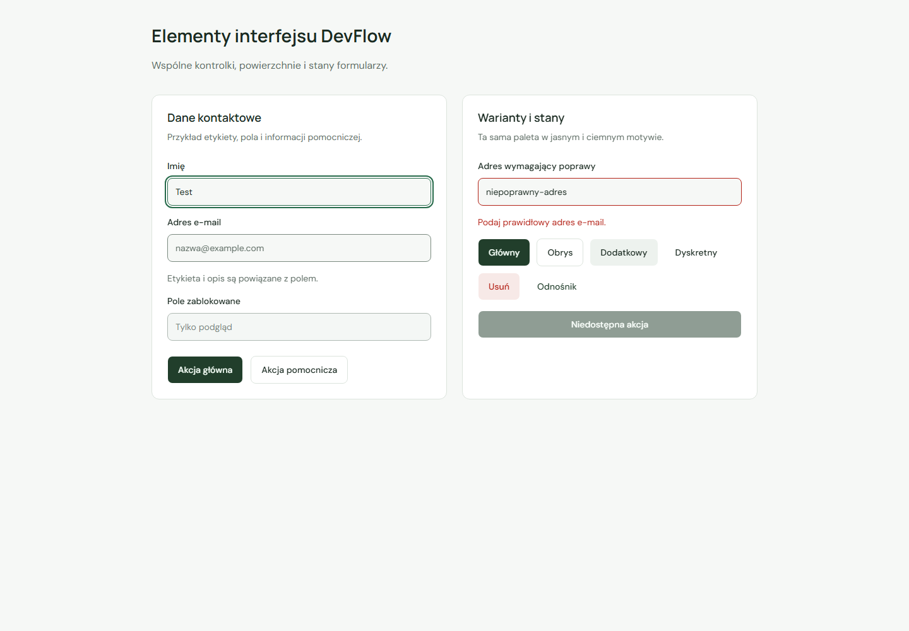

# Wspólne komponenty UI

Biblioteka obejmuje `Button`, `Card`, `Input`, `Label`, `Dialog`, `Sheet` i `Table`. To lokalne, typowane komponenty dostosowane z oficjalnego rejestru [shadcn/ui](https://ui.shadcn.com/docs/components/radix/button), wariant `radix-nova`. Są zapisane w repozytorium i można je rozwijać zgodnie z potrzebami aplikacji.

`components.json` opisuje aliasy i integrację z Tailwind CSS 4. `src/lib/utils.ts` udostępnia `cn`, które łączy klasy i rozstrzyga konflikty klas Tailwind. Warianty przycisku są w osobnym pliku, aby plik komponentu był zgodny z regułami React Fast Refresh.

## Użycie

```tsx
import { Button } from '@/components/ui/button'
import { Input } from '@/components/ui/input'
import { Label } from '@/components/ui/label'

<Label htmlFor="contact-email">Adres e-mail</Label>
<Input id="contact-email" type="email" autoComplete="email" />
<Button type="submit">Zapisz</Button>
```

`Button` domyślnie ma `type="button"`; wysłanie formularza wymaga jawnego `type="submit"`. Obsługuje warianty `default`, `outline`, `secondary`, `ghost`, `destructive` i `link` oraz rozmiary `default`, `sm`, `lg` i `icon`. Kontrolki mają co najmniej 44 px wysokości. Przycisk ikonowy wymaga dostępnej nazwy, np. `aria-label`.

Do nawigacji można użyć kompozycji z linkiem:

```tsx
<Button asChild variant="outline">
  <a href="#plan-rozwoju">Zobacz plan</a>
</Button>
```

Kompozycja przez Radix Slot zachowuje element `a`, jego adres i semantykę linku, bez zagnieżdżonego przycisku. Do zablokowanych akcji używaj natywnego `Button disabled`.

`Input` przekazuje standardowe właściwości, w tym `ref`, `required`, `disabled`, `readOnly`, `aria-invalid` i `aria-describedby`. Etykietę łącz z polem przez `htmlFor` i `id`. Przy błędzie ustaw `aria-invalid` i powiąż opis z polem przez `aria-describedby`. Komponent prezentuje stan; walidację i zapis danych zapewni właściwy formularz modułu.

`Card` udostępnia `CardHeader`, `CardTitle`, `CardDescription`, `CardContent` i `CardFooter`. Nagłówek semantyczny umieszczaj wewnątrz `CardTitle`, np. jako `h2`. Same komponenty karty są neutralnymi elementami `div`, aby można było dostosować strukturę do kontekstu.

## Dialogi i wysuwane panele

`Dialog` udostępnia `DialogTrigger`, `DialogContent`, `DialogHeader`, `DialogTitle`, `DialogDescription`, `DialogFooter` i `DialogClose`. `DialogContent` dodaje portal, przyciemnione tło i przycisk zamknięcia. Zarządzanie fokusem, obsługa Escape, ukrywanie tła przed technologiami asystującymi i zachowanie modalne korzystają z [Radix Dialog](https://www.radix-ui.com/primitives/docs/components/dialog). Kompozycja jest zgodna z modelem [shadcn/ui Dialog](https://ui.shadcn.com/docs/components/radix/dialog).

```tsx
import {
  Dialog,
  DialogClose,
  DialogContent,
  DialogDescription,
  DialogFooter,
  DialogHeader,
  DialogTitle,
  DialogTrigger,
} from '@/components/ui/dialog'

;<Dialog>
  <DialogTrigger asChild>
    <Button>Otwórz informacje</Button>
  </DialogTrigger>
  <DialogContent>
    <DialogHeader>
      <DialogTitle>Informacje o widoku</DialogTitle>
      <DialogDescription>Opis zawartości tego okna.</DialogDescription>
    </DialogHeader>
    <p>Dodatkowa treść.</p>
    <DialogFooter>
      <DialogClose asChild>
        <Button variant="outline">Wróć</Button>
      </DialogClose>
    </DialogFooter>
  </DialogContent>
</Dialog>
```

Każde okno powinno mieć tytuł i krótki opis. `closeLabel` zmienia dostępną nazwę przycisku zamknięcia; domyślnie to „Zamknij okno”. `showCloseButton={false}` pozwala zastąpić go własnym `DialogClose` z czytelną nazwą. `open` i `onOpenChange` umożliwiają kontrolę stanu, a `onOpenAutoFocus` i `onCloseAutoFocus` dostosowanie docelowego fokusu. Radix domyślnie pomija linki przy wyborze pierwszego elementu do skupienia; dla nawigacji ustaw pierwszy link jawnie.

`Sheet` korzysta z tego samego mechanizmu dialogu. Udostępnia odpowiedniki `SheetTrigger`, `SheetContent`, `SheetHeader`, `SheetTitle`, `SheetDescription`, `SheetFooter` i `SheetClose`. `SheetContent side="right"` domyślnie wysuwa się z prawej; pozostałe wartości to `left`, `top` i `bottom`. Domyślna nazwa zamknięcia to „Zamknij panel”. Długi panel ma własne przewijanie, a jego wymiary uwzględniają wysokość widocznego ekranu i bezpieczne odstępy urządzenia. [Model komponentu Sheet](https://ui.shadcn.com/docs/components/radix/sheet).

Nawigacja strony powitalnej używa `Sheet` do szerokości 1000 px. Po otwarciu aktywny jest link „Start”; Tab i Shift+Tab pozostają w panelu. Escape, kliknięcie tła i przycisk zamknięcia przywracają fokus do przycisku menu. Po wyborze sekcji fokus trafia do jej treści. Poszerzenie okna do co najmniej 1001 px zamyka panel i przenosi fokus do widocznej nawigacji desktopowej.

## Tabela

`Table` udostępnia `TableHeader`, `TableBody`, `TableFooter`, `TableRow`, `TableHead`, `TableCell` i `TableCaption`. Komponenty zachowują natywne elementy `table`, `thead`, `tbody`, `tfoot`, `tr`, `th`, `td` i `caption`. Bazują na [shadcn/ui Table](https://ui.shadcn.com/docs/components/radix/table). Podpis i nagłówki określają temat tabeli oraz relacje między komórkami, zgodnie z [poradnikiem W3C WAI](https://www.w3.org/WAI/tutorials/tables/).

```tsx
import {
  Table,
  TableBody,
  TableCaption,
  TableCell,
  TableHead,
  TableHeader,
  TableRow,
} from '@/components/ui/table'

;<Table containerProps={{ 'aria-label': 'Planowane moduły — przewijanie' }}>
  <TableCaption>Planowane moduły — zakres docelowy</TableCaption>
  <TableHeader>
    <TableRow>
      <TableHead>Moduł</TableHead>
      <TableHead>Etap</TableHead>
    </TableRow>
  </TableHeader>
  <TableBody>
    <TableRow>
      <TableHead scope="row">Projekty</TableHead>
      <TableCell>8</TableCell>
    </TableRow>
  </TableBody>
</Table>
```

`TableHead` domyślnie ustawia `scope="col"`; dla nagłówka wiersza ustaw `scope="row"`. Przy bardziej złożonych układach można przekazać natywne `id`, `headers`, `scope`, `rowSpan` i `colSpan`. Nadpisania klas i refy trafiają do odpowiednich elementów HTML.

Tabela ma obramowany kontener z przewijaniem poziomym, nazwą regionu, `tabIndex={0}` i widocznym fokusem. Tab przechodzi do kontenera, strzałki przewijają jego zawartość, a kolejny Tab pozwala przejść dalej. Kontener pozostaje punktem tabulacji także na desktopie. `containerProps` umożliwia nadanie własnej nazwy przez `aria-label` lub powiązanie opisu przez `aria-describedby`; używaj odrębnych nazw przy wielu tabelach. `className` na `Table` styluje element `table`, a `containerProps.className` jego kontener. Minimalną szerokość szerokiej tabeli ustalaj na potrzeby konkretnego zestawu kolumn.

Treść komórek domyślnie się zawija. Pusty widok można przekazać jako wiersz z `TableCell colSpan={liczbaKolumn}`. Dane, sortowanie, filtry i paginację zapewni właściwy moduł; komponent nie dodaje własnej logiki danych ani dodatkowych zależności.

Podgląd poniżej powstał poza aplikacją i używa istniejących opisów planowanych modułów. Przełącznik pustego widoku służy wyłącznie kontroli komponentu.

[Tabela — jasny motyw](screenshots/table-light.png) · [Ciemny motyw](screenshots/table-dark.png) · [Widok mobilny](screenshots/table-mobile.png)

## Integracja z motywem

`src/styles/ui.css` mapuje semantyczne klasy shadcn/ui na istniejącą paletę DevFlow, zgodnie z [modelem tokenów shadcn/ui](https://ui.shadcn.com/docs/theming). Na przykład `bg-card` używa powierzchni, `text-muted-foreground` tekstu pomocniczego, a `bg-muted` delikatnego tła. Nie zmienia to znaczenia starszej zmiennej `--muted`, która określa kolor tekstu w ekranie powitalnym.

Wariant Tailwind `dark:` rozpoznaje `data-theme="dark"`. Pola mają mocniejszy obrys niż karty; stan błędu ma osobny kolor. Bazowe resety i domyślny fokus są w warstwie `base`, aby klasy komponentów mogły je poprawnie dostosowywać.

`src/styles/overlays.css` zawiera style dialogu i czterech kierunków panelu w warstwie `components`. Importuj je centralnie z `globals.css` po Tailwind CSS i `ui.css`; nie dodawaj wcześniejszego importu warstwy z pliku komponentu. Zachowuje to pierwszeństwo stylów komponentów nad resetem. Dialog i panel używają kolorów bieżącego motywu oraz wyłączają animacje przy ograniczeniu ruchu.

`ActionLink` korzysta z `Button`, karty katalogu z `Card`, a menu mobilne z `Sheet`. Pola formularza i centralny `Dialog` są przygotowane do kolejnych modułów. Podgląd dialogu powstaje poza aplikacją na potrzeby kontroli komponentów.

## Weryfikacja i podgląd

- Testy komponentów obejmują domyślny typ przycisku, wysyłanie formularza, akcję zablokowaną, semantykę linku, etykietę, fokus, opis błędu, przekazanie refa i pole zablokowane.
- Testy `Dialog` i `Sheet` sprawdzają tytuł, opis, ukrycie tła, początkowy fokus, zapętlenie Tab i Shift+Tab, Escape, powrót fokusu oraz własną akcję zamknięcia.
- Pełne E2E sprawdzają istniejący ekran po wykorzystaniu wspólnych przycisków i kart.
- Scenariusze panelu mobilnego obejmują blokadę i przywracanie przewijania, wszystkie sposoby zamknięcia, przejście do sekcji, zmianę rozmiaru okna oraz widok 320 × 320 px. Audyt axe sprawdza stronę z panelem otwartym i zamkniętym w obu motywach.
- W odizolowanym podglądzie czterech komponentów sprawdzono motywy, fokus, wysokość 44 px, font 16 px na telefonie, brak przepełnienia oraz automatyczny audyt axe. Podgląd nie jest formularzem biznesowym w aplikacji.
- Osobny podgląd dialogu oraz panelu z każdej z czterech stron przeszedł kontrolę w 20 kombinacjach rozmiarów i motywów. Sprawdzono klawiaturę, granice ekranu, błędy wykonania i axe. Aktualny pełny zestaw aplikacji, w tym routing i układ: 17 testów React i 74 scenariusze Playwright. `Sheet` obsługuje również lewe menu aplikacji, opisane w [app-shell.md](app-shell.md).
- Tabela przeszła kontrolę przeglądarkową w 6 wariantach szerokości i motywu: 320, 390, 640, 768 i 1440 px. Sprawdzono podpis i nagłówki, Tab i Shift+Tab, widoczny fokus, przewijanie strzałką, przejście do pustego widoku i powrót oraz brak poziomego przepełnienia strony i błędów wykonania. Audyt axe nie wykrył naruszeń sprawdzanych reguł zarówno z danymi, jak i bez danych. Tabela nie jest jeszcze używana na publicznej stronie; jej podgląd jest osobną kontrolą, poza zestawem E2E aplikacji.

```powershell
npm test -- src/components/ui/primitives.test.tsx
npm test -- src/components/ui/overlays.test.tsx
npm run build
npm run test:e2e -- e2e/mobile-navigation.spec.ts
npm run dev
```

Po uruchomieniu aplikacji sprawdź akcje „Poznaj możliwości” i „Zobacz plan” oraz katalog w obu motywach. Zwęź okno do 1000 px lub mniej, otwórz menu i sprawdź Tab, Shift+Tab, Escape, wybór sekcji oraz zmianę szerokości na desktopową.



[Ciemny motyw](screenshots/ui-primitives-dark.png) · [Widok mobilny](screenshots/ui-primitives-mobile.png)

[Dialog — odizolowany podgląd w ciemnym motywie](screenshots/dialog-dark.png) · [Dialog na małym ekranie](screenshots/dialog-mobile.png) · [Panel nawigacji w aplikacji](screenshots/theme-selector-mobile.png)

Źródło i licencja adaptowanego kodu: [third-party-notices.md](third-party-notices.md).
