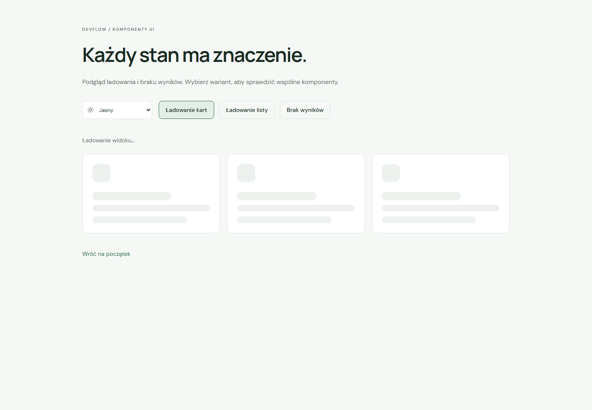

# Stany ładowania i braku danych

`Skeleton` jest dekoracyjnym elementem shadcn/ui. `LoadingState` i `EmptyState` to wspólne komponenty złożone DevFlow, przygotowane bez zależności od danych biznesowych i pobierania z API.

## Ładowanie

```tsx
import { LoadingState } from '@/components/shared/loading-state'

<LoadingState label="Ładowanie projektów…" layout="cards" />
<LoadingState label="Ładowanie wyników…" layout="list" />
```

Domyślny układ to `cards`, a etykieta „Ładowanie danych…”. Wariant kart i listy zawiera po trzy dekoracyjne elementy. Informacja tekstowa jest widoczna i ma `role="status"` oraz `aria-atomic="true"`. Grupa szkieletów ma `aria-busy="true"`; status znajduje się poza nią, aby oznaczenie zajętości nie wstrzymywało komunikatu ładowania. Komponent nie przenosi fokusu.

Po zakończeniu rzeczywistego zapytania zastąp `LoadingState` treścią, stanem pustym lub błędem. Właściwy moduł odpowiada za wynik i komunikat zakończenia operacji. Nie pokazuj ładowania dla widoku, który nie pobiera danych. [Komunikaty statusu — W3C WAI](https://www.w3.org/WAI/WCAG22/Understanding/status-messages.html) · [Znaczenie aria-busy](https://developer.mozilla.org/en-US/docs/Web/Accessibility/ARIA/Reference/Attributes/aria-busy).

`Skeleton` z `src/components/ui/skeleton.tsx` umożliwia własne kompozycje przez `className`. Ma wymuszone `aria-hidden="true"`; nie przyjmuje dzieci ani parametrów roli i kolejności tabulacji. Dekoracje nie zawierają interaktywnych kontrolek. Animacja pulsowania działa wyłącznie przy braku preferencji ograniczenia ruchu. [shadcn/ui Skeleton](https://ui.shadcn.com/docs/components/radix/skeleton).

## Brak treści

```tsx
import { SearchX } from 'lucide-react'
import { EmptyState } from '@/components/shared/empty-state'
import { Button } from '@/components/ui/button'

;<EmptyState
  title="Brak wyników"
  description="Zmień kryteria wyszukiwania lub wyczyść filtry."
  icon={<SearchX size={30} />}
>
  <Button onClick={clearFilters}>Wyczyść filtry</Button>
</EmptyState>
```

`title` i `description` są wymagane. Komponent jest nazwaną sekcją z powiązanym nagłówkiem i opisem; każda instancja ma własne identyfikatory. Domyślny poziom nagłówka to `h2`; `headingLevel={3}` pozwala umieścić stan w sekcji z istniejącym `h2`.

Opcjonalne `icon` jest dekoracyjne i ukryte przed czytnikiem ekranu. Nie wkładaj do tego miejsca interaktywnych elementów. `children` mieści właściwe przyciski lub linki prowadzące do kolejnego działania. Komponent nie dodaje własnych akcji, automatycznych komunikatów ani zmiany fokusu. Dla wyników zmieniających się dynamicznie właściwy moduł powinien ogłaszać krótką informację o liczbie lub braku wyników w swoim regionie statusu.

`EmptyState` obsługuje też neutralny komunikat o niedostępnej jeszcze treści. Planowane moduły już go używają z informacją „Ten moduł jest w planie” i działającymi linkami nawigacji. Opis ten nie oznacza pustej bazy danych. `LoadingState` zostanie włączony do modułów wraz z rzeczywistym pobieraniem danych.

## Style i weryfikacja

`src/styles/ui-states.css` używa istniejących tokenów, jest importowany centralnie z `globals.css` i dostosowuje układ do małych ekranów. Nie dodano zależności ani sztucznych opóźnień.

```powershell
npm test -- src/components/shared/ui-states.test.tsx
npm run build
npm run test:e2e -- e2e/ui-states.spec.ts
```

Aktualny pełny zestaw: 27 testów React i 76 scenariuszy Playwright. Testy sprawdzają przejście od zajętej zawartości do pustego stanu, zachowanie fokusu, wykonanie akcji, powiązanie opisów wielu sekcji oraz nawigację z planowanego modułu klawiaturą.

Odizolowany podgląd sprawdzono w pięciu wariantach rozmiaru i motywu: 320, 390, 768 i 1440 px, z jasnym i ciemnym desktopem. Każdy obejmował ładowanie kart, listy i pusty wynik — łącznie 15 widoków. Sprawdzono klawiaturę, status i zajętość, dekoracyjne szkielety, włączoną i ograniczoną animację, brak poziomego przepełnienia oraz audyty axe. Podgląd nie jest dodatkową stroną aplikacji. Automatyczne kontrole nie zastępują pełnego audytu dostępności.

## Podgląd komponentów



[Lista na telefonie](screenshots/loading-state-mobile.png) · [Pusty widok w ciemnym motywie](screenshots/empty-state-dark.png) · [Mały ekran](screenshots/empty-state-mobile.png)
